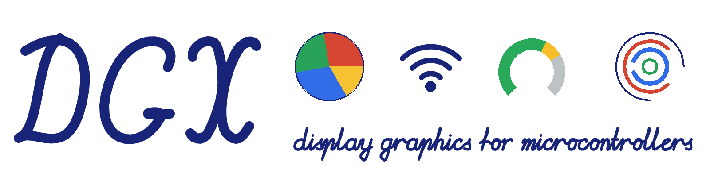
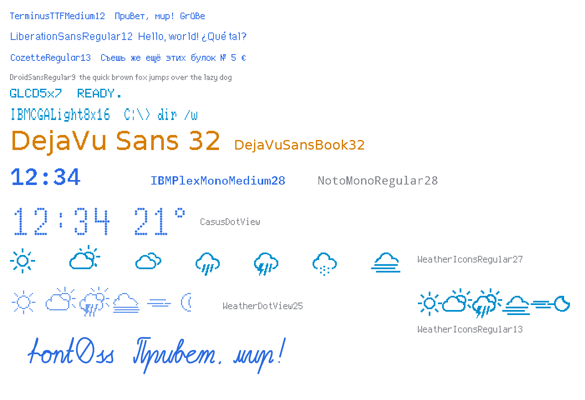
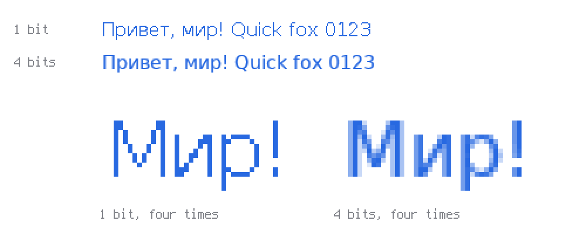
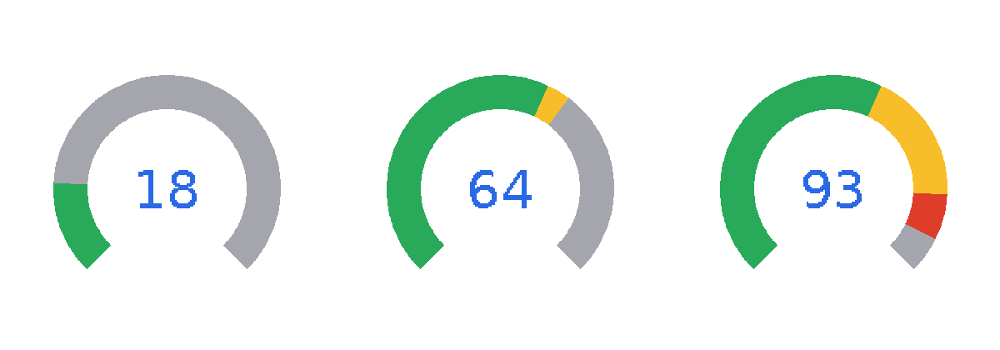
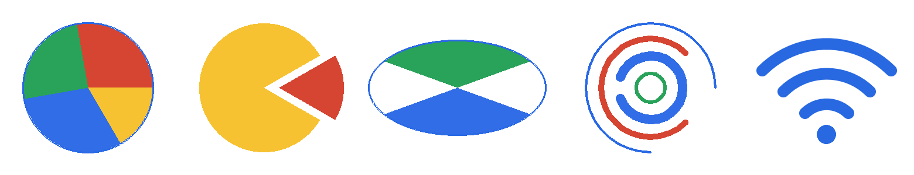
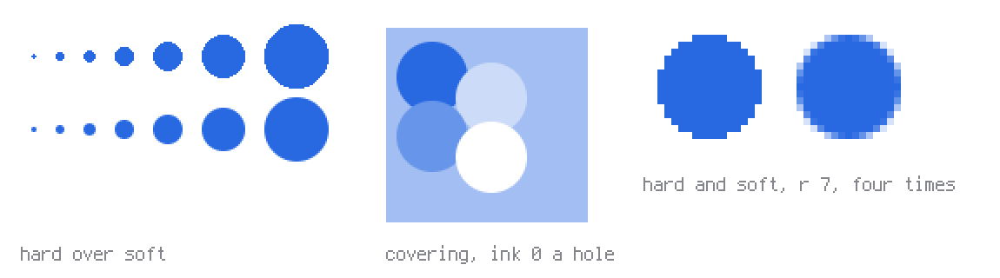
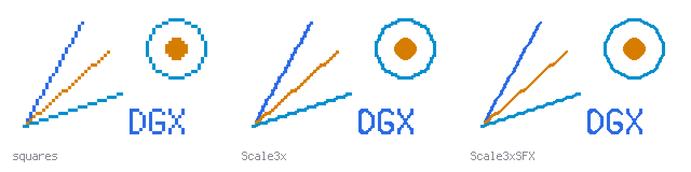
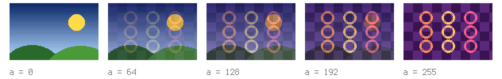
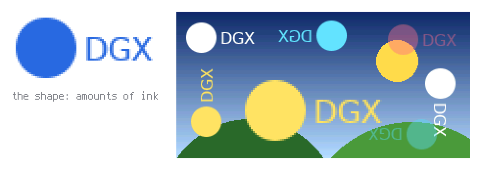
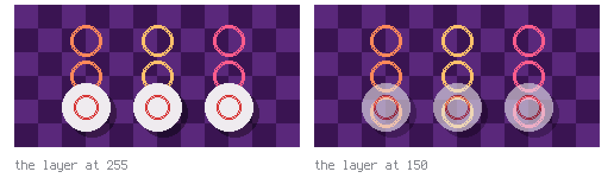

# DGX

<picture>
  <source media="(prefers-color-scheme: dark)" srcset="https://raw.githubusercontent.com/jef-sure/esp32-component-dgx/main/docs/images/banner-dark.png">
  
</picture>

DGX is a small display graphics library for microcontrollers. I started writing
it years ago, back when most people reached for Adafruit GFX or TFT_eSPI, and
I wanted something shaped to my own taste: a clean split between bus, screen
and drawing code, no hidden global state, possibility to use several equal
screens simultaneously.

Today it lives as an ESP-IDF component with drivers for a handful of common
panels, a couple of RAM-backed virtual screens, a UTF-8 text renderer, and a
small offline tool for converting fonts. It drives the MIPI-DSI panels of an
ESP32-P4 without tearing, and puts a picture drawn small on a large display
scaled and smoothed on the way, as a game port needs. On top of that it
animates: dots that morph one glyph into another, and handwritten fonts
whose text is written stroke by stroke by a pen or turns into another text.
Every picture in this README was drawn by DGX's own code, run on a PC.

## Contents

- [Getting started](#getting-started)
- [A minimal example](#a-minimal-example)
- [Recipes](#recipes)
  - [Animation without flicker](#animation-without-flicker)
  - [A monochrome OLED](#a-monochrome-oled)
  - [An e-paper panel of black, white and red](#an-e-paper-panel-of-black-white-and-red)
  - [Text in your own font](#text-in-your-own-font)
  - [Fonts made at build time](#fonts-made-at-build-time)
  - [Text with soft edges](#text-with-soft-edges)
  - [A gauge](#a-gauge)
  - [A pie chart, arcs, a Wi-Fi icon](#a-pie-chart-arcs-a-wi-fi-icon)
  - [A circle with a soft edge](#a-circle-with-a-soft-edge)
  - [Scrolling text](#scrolling-text)
  - [A picture at any size and angle](#a-picture-at-any-size-and-angle)
  - [Pixel art made larger](#pixel-art-made-larger)
  - [A sprite or an icon from flash](#a-sprite-or-an-icon-from-flash)
  - [A palette, a fade and a flash](#a-palette-a-fade-and-a-flash)
  - [Crossfade between two pictures](#crossfade-between-two-pictures)
  - [A soft shape stamped anywhere](#a-soft-shape-stamped-anywhere)
  - [Translucent buttons over a picture](#translucent-buttons-over-a-picture)
  - [Morph one glyph into another](#morph-one-glyph-into-another)
  - [Handwritten text](#handwritten-text)
  - [Morph handwritten text](#morph-handwritten-text)
  - [A MIPI-DSI display without tearing](#a-mipi-dsi-display-without-tearing)
  - [Rotate the screen](#rotate-the-screen)
  - [Draw from several tasks](#draw-from-several-tasks)
  - [An Arduino sketch](#an-arduino-sketch)
  - [LVGL on top of DGX](#lvgl-on-top-of-dgx)
  - [An effect on the computer](#an-effect-on-the-computer)
- [Examples](#examples)
- [How fast](#how-fast)
- [What's in the box](#whats-in-the-box)
- [Documentation](#documentation)
- [License](#license)

## Getting started

DGX is an ESP-IDF component, published in the
[ESP Component Registry](https://components.espressif.com/components/jef-sure/dgx)
as `jef-sure/dgx`. Add it to a project:

```sh
idf.py add-dependency "jef-sure/dgx^0.11.0"
```

or put it into `main/idf_component.yml` yourself:

```yaml
dependencies:
  jef-sure/dgx: "^0.11.0"
```

Then enable the drivers you need in `menuconfig`, under the **DGX** menu. A
driver is offered only once a transport it works on is enabled, so enable both;
in `sdkconfig.defaults` a driver option without its transport is silently
dropped, and the link fails later. Virtual screens, which most recipes below
draw into, need `CONFIG_DGX_ENABLE_VSCREEN`. To work on DGX itself, check the
repository out under `components/` instead; a git submodule at
`components/dgx` works well.

## A minimal example

Here's a complete setup for an ST7789 panel over SPI:

```c
#include "bus/dgx_spi_esp32.h"
#include "drivers/st7789.h"
#include "dgx_bits.h"
#include "dgx_colors.h"
#include "dgx_draw.h"
#include "dgx_font.h"
#include "fonts/LiberationSansRegular12.h"

// 1. create a bus
dgx_bus_protocols_t *bus =
  dgx_spi_init(SPI3_HOST, SPI_DMA_CH_AUTO,
               GPIO_NUM_23, GPIO_NUM_19,
               GPIO_NUM_18, GPIO_NUM_5,
               GPIO_NUM_27, 40 * 1000 * 1000, 0);

// 2. create a screen on top of that bus
dgx_screen_t *scr = dgx_st7789_init(bus, GPIO_NUM_33, GPIO_NUM_NC, 16, DgxScreenRGB, ST7789_RESOLUTION_240x320);

// 3. draw something
dgx_fill_rectangle(scr, 0, 0, scr->width, scr->height,
                   DGX_BLACK(dgx_rgb_to_16));
dgx_font_string_utf8_screen(scr, 10, 18, "Hello world",
                            DGX_WHITE(dgx_rgb_to_16),
                            DgxOutputNormal, 1, LiberationSansRegular12(),
                            NULL, NULL);
```

[examples/screen_demo](https://github.com/jef-sure/esp32-component-dgx/tree/main/examples/screen_demo) is the same program in full,
for an ILI9341 on the usual pins of an ESP32.

## Recipes

Short answers to the things people look for first. Most recipes name a
complete example to run and read; the functions are listed in the
[API reference](https://github.com/jef-sure/esp32-component-dgx/blob/main/docs/api-en.md#api-reference).

### Animation without flicker

Draw each frame into a virtual screen in RAM, then send the finished frame
to the panel in one go.

```c
#include "drivers/vscreen.h"

dgx_screen_t *frame = dgx_vscreen_init(scr->width, scr->height, 16, DgxScreenRGB);

for (int x = 0; x < scr->width; ++x) {
    dgx_fill_rectangle(frame, 0, 0, frame->width, frame->height, DGX_BLACK(dgx_rgb_to_16));
    dgx_solid_circle(frame, x, frame->height / 2, 12, DGX_CYAN(dgx_rgb_to_16));
    dgx_vscreen_to_screen(scr, 0, 0, frame, 0);
}
```

To send only what has changed, keep a batch open on the virtual screen and
ask it for the changed rectangle. Open the batch once, before anything is
drawn, and leave it open. Any batch that closes at depth 0, including one a
drawing function opens for itself, passes the changes to the virtual
screen's `update_screen()`, which does nothing, and they are lost.

```c
dgx_screen_progress_up(frame);          // once, before anything is drawn, and left open

draw_something(frame);
int left, top, width, height;
if (dgx_screen_take_dirty(frame, &left, &top, &width, &height)) {
    dgx_vscreen_region_to_screen(scr, left, top, frame, left, top, width, height, 0);
}
```

Example: [examples/hw_soft_pen_demo](https://github.com/jef-sure/esp32-component-dgx/tree/main/examples/hw_soft_pen_demo). More calls:
[Virtual screens](https://github.com/jef-sure/esp32-component-dgx/blob/main/docs/api-en.md#virtual-screens-api).

### A monochrome OLED

The same drawing calls work. A color is on (non-zero) or off (zero), and the
driver sends its RAM buffer to the panel for you.

```c
#include "bus/dgx_i2c_esp32.h"
#include "drivers/ssd1306.h"
#include "fonts/TerminusTTFMedium12.h"

dgx_bus_protocols_t *bus = dgx_i2c_init(I2C_NUM_0, 0x3C, GPIO_NUM_21, GPIO_NUM_22, 400000);
dgx_screen_t *oled = dgx_ssd1306_init(bus, SSD1306_128X64, 0, GPIO_NUM_NC);

dgx_fill_rectangle(oled, 0, 0, oled->width, oled->height, 0);
dgx_font_string_utf8_screen(oled, 0, 12, "Hello OLED", 1, DgxOutputNormal, 1,
                            TerminusTTFMedium12(), NULL, NULL);
```

Every monochrome panel here is drawn into a virtual screen in RAM, and the
driver sends the panel what has changed: SSD1306, SSD1309, SH1106 and ST7565R
keep a page screen laid out as the controller wants its bytes, ST7920 an
ordinary virtual screen at 1 bit a pixel.
Outside a batch the changed rectangle goes to the panel after every
primitive, so a frame drawn in several calls can be seen half done.
Wrap the frame in a batch and it reaches the panel in one transfer, with no
flicker and no second screen of your own:

```c
dgx_screen_progress_up(oled);
draw_frame(oled);               // clear, text, figures: nothing is sent yet
dgx_screen_progress_down(oled); // the changed rectangle goes to the panel once
```

### An e-paper panel of black, white and red

Drawing changes the picture in RAM only, kept as the controller takes it:
two planes of a bit a pixel, 9.5 KB for the 2.9" module. The panel shows it
when you call `dgx_ssd1680_refresh()`: the whole glass changes in about 20 s,
flashing several times meanwhile, and keeps the picture with no power. A
color is one of the three inks, `DGX_BWR_BLACK`, `DGX_BWR_WHITE` and
`DGX_BWR_RED`; `dgx_rgb_to_bwr` turns any other into the nearest of them, as
in `DGX_ORANGE(dgx_rgb_to_bwr)`. A new screen is white.

```c
#include "bus/dgx_spi_esp32.h"
#include "dgx_bits.h"
#include "drivers/ssd1680.h"
#include "fonts/DejaVuSansBook32.h"

dgx_bus_protocols_t *bus = dgx_spi_init(SPI3_HOST, SPI_DMA_CH_AUTO, GPIO_NUM_23, GPIO_NUM_NC, GPIO_NUM_18,
                                        GPIO_NUM_5, GPIO_NUM_17, 10 * 1000 * 1000, 0); // MOSI, MISO, SCK, CS, D/C
dgx_screen_t *paper = dgx_ssd1680_init(bus, SSD1680_128X296_BWR, GPIO_NUM_16, GPIO_NUM_4); // RES, BUSY
// 296x128, the module lying with its pins on the right
dgx_ssd1680_orientation(paper, DgxScreenLeftRight, DgxScreenBottomTop, true);

dgx_font_context_t text = {.scr = paper, .font = DejaVuSansBook32(), .color = DGX_BWR_BLACK};
dgx_font_draw(&text, 8, 34, "Hello");
dgx_fill_rectangle(paper, 8, 44, 280, 6, DGX_BWR_RED);
dgx_ssd1680_refresh(paper); // returns once the picture is sent
while (dgx_ssd1680_busy(paper)) vTaskDelay(pdMS_TO_TICKS(100));
```

A program may draw the next picture while the glass changes; the next call
of the driver waits for the end. The colors are not levels that mix: a font
of soft edges is drawn with `DGX_FONT_MONO`.

### Text in your own font

DGX comes with a few fonts, in `src/fonts/`:

<picture>
  <source media="(prefers-color-scheme: dark)" srcset="https://raw.githubusercontent.com/jef-sure/esp32-component-dgx/main/docs/images/fonts-dark.png">
  
</picture>

When they are not enough, `font2c` converts a TTF or BDF font into a C
source/header pair. Give it the pixel size and the Unicode ranges you need:

```sh
cc font2c/font2c.c -o font2c/font2c $(pkg-config --cflags --libs freetype2)
./font2c/font2c path/to/YourFont.ttf 16 0x20 0x7e 0x410 0x44f
```

Move the `.c` file into `src/fonts/` and the `.h` file into
`include/fonts/`, and use the font like a bundled one; the next build picks
the new file up by itself:

```c
#include "fonts/YourFontRegular16.h"

dgx_font_string_utf8_screen(scr, 10, 30, "Привет", color, DgxOutputNormal, 1,
                            YourFontRegular16(), NULL, NULL);
```

Details: [font2c/README.md](https://github.com/jef-sure/esp32-component-dgx/blob/main/font2c/README.md).

A glyph that comes out wrong on the panel is fixed by hand in the font
editor, [font-editor/index.html](https://github.com/jef-sure/esp32-component-dgx/blob/main/font-editor/README.md): open the `.c`,
redraw the glyph and save the patch, `YourFontRegular16.patch.json`. Then
make the font again with it, `./font2c/font2c -p YourFontRegular16.patch.json
path/to/YourFont.ttf 16 ...`; a font made at build time finds its patch by
itself, see "Glyphs fixed by hand" in [docs/fonts-en.md](https://github.com/jef-sure/esp32-component-dgx/blob/main/docs/fonts-en.md).

### Fonts made at build time

A program, and the components it uses, declare the fonts they need in
their CMakeLists files: the characters, the size and the face of each one.
DGX renders all of them while the program is built, one font per face and
size, and gives every need a function. Nothing is run by hand.

```cmake
# main/CMakeLists.txt, after idf_component_register()
dgx_fonts_board(PIXELS 320 240 MM 57.6 43.2)             # the display, for sizes in millimeters
dgx_fonts_rules(../fonts.rules)                          # which faces may be used at which sizes
dgx_font_need(body SIZE 3mm MONO TEXTS strings.txt)      # a monospaced face picked by the rules, with the characters of the strings
dgx_font_need(title SIZE 5mm POSTSCRIPT DejaVuSans-Bold TEXTS strings.txt)  # an exact face, 5 mm high
dgx_font_need(clock DGX DejaVuSansBook32 LETTERS "0123456789:")             # one of DGX's fonts, used as is; its characters are checked
```

```c
#include "dgx_fonts.h"

dgx_font_string_utf8_screen(scr, 10, 40, "Привет", ink, DgxOutputNormal, 1, dgx_font_body(), NULL, NULL);
```

A font is rendered by `font2c` on the build machine from a TTF or OTF, or
from any font file a need names, a BDF at a size it has, with the
characters of the need's texts and no others; an existing font must
already have them, or the build stops. The build machine needs a C compiler
with FreeType, and fontconfig; a project without needs requires nothing
extra. Needs, sizes, characters, the rules, needs from a component and what
the build produces: [docs/fonts-en.md](https://github.com/jef-sure/esp32-component-dgx/blob/main/docs/fonts-en.md)
([Russian](https://github.com/jef-sure/esp32-component-dgx/blob/main/docs/fonts-ru.md)). The example: [fonts_demo](https://github.com/jef-sure/esp32-component-dgx/tree/main/examples/fonts_demo).

DGX does not check font licenses; you do. Each build lists every font the
program uses, with what its file says about its license, in
`build/dgx_fonts/fonts-used.txt`. A `deny` line in the rules keeps a font
out, even when a component asks for it by name; the rule `strict` admits
only the fonts the rules allow. See
[Fonts and their licenses](https://github.com/jef-sure/esp32-component-dgx/blob/main/docs/fonts-en.md#fonts-and-their-licenses).

### Text with soft edges

A font of 4 bits a pixel is anti-aliased: it keeps how much of each pixel a
letter covers, and the edges of its letters are mixed with what lies under
them instead of standing in steps. Ask for one with `BITS 4` (`BITS 2` makes a smaller font
with coarser edges), or with `font2c -b 4`:

<picture>
  <source media="(prefers-color-scheme: dark)" srcset="https://raw.githubusercontent.com/jef-sure/esp32-component-dgx/main/docs/images/soft-text-dark.png">
  
</picture>

```cmake
dgx_font_need(label SIZE 16px POSTSCRIPT DejaVuSans BITS 4 TEXTS strings.txt)
```

Draw it with a context: the screen, the font, the colors and the flags a
program keeps for one kind of text, given to `dgx_font_draw()` with the
place and the text. Fill it by the names of its members; whatever is left
out is zero, which is upright, at the size of the font, with no flags.

```c
#include "dgx_fonts.h"

const dgx_font_context_t label = {.scr = lcd, .font = dgx_font_label(), .color = ink, .bg = paper, .flags = DGX_FONT_BG};
int x = 10;
x += dgx_font_draw(&label, x, 40, "Привет, ");       // returns how far the text goes along its line
dgx_font_draw(&label, x, 40, "мир");
```

Where the colors under an edge come from:

- A virtual screen of 12, 16, 18 or 24 bits and a DSI display hold their
  pixels, and the edges are mixed with them: text over a picture needs no
  flag. On an 8-bit virtual screen a pixel is an amount of ink, and the
  amounts are mixed; on a 4-bit one, as the SSD1322 keeps, a gray level. On a
  screen of 4 or 8 bits whose pixels are indices into a table of colors the
  mixed edges come out in wrong colors: draw there with `DGX_FONT_MONO`.
- A display behind a bus (an ILI9341, an ST7789, ...) cannot be read, so the
  program names the paper: `DGX_FONT_BG` mixes the edges with `bg`, and
  `DGX_FONT_FILL` also fills the cell of the text with it, as high as the
  font: a number drawn again over itself replaces the one before without an
  erase. On a display of 16 bits a pixel the cell goes in one pass, every
  pixel of it written once, so the number does not blink; on one of 18 or 24
  bits the cell is filled first and the letters drawn after, and a number
  that must not blink there is drawn into a virtual screen and sent whole.
  Without either flag, such a display and a screen of one bit draw the font
  cut to one bit, as `DGX_FONT_MONO` asks for anywhere. Cut so, a small font
  comes out heavier and its stems uneven, one a pixel wider than the next,
  as each lies on the pixels: name the paper, or take a font of one bit.
- `DGX_FONT_HARD` draws every pixel a letter touches in full: it erases soft
  text, which drawn again in the color of the paper would leave a halo.

Which of the three to take, what each writes and leaves, and how much the
cell of `DGX_FONT_FILL` takes:
[The paper of a text](https://github.com/jef-sure/esp32-component-dgx/blob/main/docs/api-en.md#the-paper-of-a-text-no-flag-dgx_font_bg-or-dgx_font_fill)
in the API reference.

Fonts of one bit draw as before with a context too, and the old calls draw a
soft font as a context without flags does. The example:
[soft_text_demo](https://github.com/jef-sure/esp32-component-dgx/tree/main/examples/soft_text_demo); the depth, its cost in flash and
its limits: [Soft edges](https://github.com/jef-sure/esp32-component-dgx/blob/main/docs/fonts-en.md#soft-edges) in docs/fonts-en.md.

### A gauge

<picture>
  <source media="(prefers-color-scheme: dark)" srcset="https://raw.githubusercontent.com/jef-sure/esp32-component-dgx/main/docs/images/gauge-dark.png">
  
</picture>

```c
#include "dgx_gauge.h"

static uint32_t gauge_color(int value) {
    return value < 70 ? DGX_GREEN(dgx_rgb_to_16) : DGX_RED(dgx_rgb_to_16);
}

dgx_gauge_t gauge;
dgx_gauge_init(&gauge, scr,
               scr->width / 2, scr->height / 2, // center
               40, 12,                          // inner radius, ring width
               135.0f, 270,                     // start angle in degrees, sweep clockwise
               0, 100,                          // value range
               DGX_DARKGREY(dgx_rgb_to_16),     // color of the inactive steps
               gauge_color);                    // draws the empty ring

dgx_gauge_set_value(&gauge, 42);                // redraws only the steps that changed
```

### A pie chart, arcs, a Wi-Fi icon

Angles are in degrees, counter-clockwise, and 0 points to the right. With
equal radii an ellipse is a circle.

<picture>
  <source media="(prefers-color-scheme: dark)" srcset="https://raw.githubusercontent.com/jef-sure/esp32-component-dgx/main/docs/images/figures-dark.png">
  
</picture>

```c
// a pie chart
dgx_solid_sector(scr, cx, cy, r, r, 0, 100, red);
dgx_solid_sector(scr, cx, cy, r, r, 100, 190, green);
dgx_solid_sector(scr, cx, cy, r, r, 190, 360, blue);
dgx_draw_ellipse(scr, cx, cy, r, r, white);     // the outline

// a Wi-Fi icon: a dot and three quarter-turn arcs, pen 3 pixels wide
dgx_solid_circle(scr, cx, cy, 2, white);
for (int i = 1; i <= 3; ++i) dgx_draw_arc(scr, cx, cy, i * 9, i * 9, 45, 135, 3, white);
```

Example: [examples/figures_scroll_demo](https://github.com/jef-sure/esp32-component-dgx/tree/main/examples/figures_scroll_demo).

### A circle with a soft edge

A filled circle takes the soft edge of the pen: add `DGX_PEN_SOFT` to its
radius. The edge is mixed with what lies under it by how much of each pixel
the circle covers, so a pixel has to be an amount of ink: draw on an 8-bit
virtual screen and send it to the display through a table of colors from the
paper to the ink.

<picture>
  <source media="(prefers-color-scheme: dark)" srcset="https://raw.githubusercontent.com/jef-sure/esp32-component-dgx/main/docs/images/soft-circle-dark.png">
  
</picture>

```c
dgx_screen_t   *band = dgx_vscreen_init(320, 60, 8, DgxScreenRGB);
static uint16_t lut[256];
dgx_lut_gradient(lut, 0, 256, 0x102040, 0xffc800);           // from the paper to the ink, as 0xRRGGBB

dgx_fill_rectangle(band, 0, 0, band->width, band->height, 0);  // paper
dgx_solid_circle(band, 30, 30, DGX_PEN_SOFT | 20, 255);        // a circle of ink
dgx_solid_circle(band, 50, 30, DGX_PEN_SOFT | 12, 0);          // ink 0: a circle of paper over it
dgx_vscreen8_to_screen16(lcd, 0, 100, band, lut, 0);
```

The circle covers what is under it, as the hard one does.
`DGX_PEN_SOFT | DGX_PEN_MAX | r` keeps the larger ink instead, as the pen
does, and is then the dot of the pen byte for byte. On any other screen the
circle is the hard one. Details: [A soft circle](https://github.com/jef-sure/esp32-component-dgx/blob/main/docs/pen-en.md#a-soft-circle)
in docs/pen-en.md; the call: [Drawing primitives](https://github.com/jef-sure/esp32-component-dgx/blob/main/docs/api-en.md#drawing-primitives).

### Scrolling text

`dgx_scroll()` moves the contents of a rectangle and fills the freed strip.
The usual way is to scroll a virtual screen and send it to the display:

```c
// a terminal: everything moves up by one line, the new line is drawn at the bottom
dgx_scroll(page, 0, 0, page->width, page->height, 0, -line_height, paper);
dgx_font_string_utf8_screen(page, 4, page->height - 4, text, ink, DgxOutputNormal, 1,
                            font, NULL, NULL);
dgx_vscreen_to_screen(lcd, 0, 0, page, 0);
```

Some displays can be scrolled directly, without a virtual screen: an ILI9341
scrolls by its own hardware along the long side of the panel, an ST77916 along
y of a screen upright, and a MIPI-DSI display is scrolled in its frame buffer. The call is the same; it returns
`ESP_OK`, or `ESP_ERR_NOT_SUPPORTED` when the display cannot do that scroll:

```c
// an ILI9341 in portrait: the rows below a 24-row header move up, the header stays
dgx_scroll(lcd, 0, 24, lcd->width, lcd->height - 24, 0, -line_height, paper);
```

On such a panel a move costs its commands and the fill of the strip that
leaves. When the new line or column is drawn right after the
move anyway, use `dgx_scroll_no_fill()`: the same move without the fill, and
on the panel it is the commands alone.

In that case a virtual screen always works: scroll the virtual screen as
above and send it to the display. It can be sent in any
orientation, so the text scrolls the way you need whatever way the panel is
mounted:

```c
dgx_vscreen_to_screen(lcd, 0, 0, page, DGX_VSCREEN_ORIENTED(DgxOutputRotate90CW));
```

Example: [examples/figures_scroll_demo](https://github.com/jef-sure/esp32-component-dgx/tree/main/examples/figures_scroll_demo), a
terminal and a chart on both kinds of display. The rules are under
[Drawing primitives](https://github.com/jef-sure/esp32-component-dgx/blob/main/docs/api-en.md#drawing-primitives).

### A picture at any size and angle

Draw the picture once into a virtual screen, then put it on the display at
any size and onto any four corners.

```c
// the texture: the same color depth as the screen it goes to
dgx_screen_t *tex = dgx_vscreen_init(64, 24, 16, DgxScreenRGB);
dgx_fill_rectangle(tex, 0, 0, tex->width, tex->height, DGX_NAVY(dgx_rgb_to_16));
dgx_font_string_utf8_screen(tex, 6, 17, "DGX", DGX_WHITE(dgx_rgb_to_16),
                            DgxOutputNormal, 1, LiberationSansRegular12(), NULL, NULL);

// three times larger
dgx_draw_texture_rect(scr, 10, 10, 192, 72, tex, 0, 0, tex->width, tex->height);

// onto four corners: top-left, top-right, bottom-right, bottom-left
const dgx_point_2d_t card[4] = {{40, 110}, {200, 100}, {220, 170}, {20, 180}};
dgx_draw_texture_quad(scr, card, tex, 0, 0, tex->width, tex->height);

// mirrored: swap the left and the right corners
const dgx_point_2d_t mirrored[4] = {{237, 10}, {174, 10}, {174, 33}, {237, 33}};
dgx_draw_texture_quad(scr, mirrored, tex, 0, 0, tex->width, tex->height);
```

To rotate or animate the picture, compute the four corners again for every
frame. The quad must be convex; the mapping is affine, without perspective.
For a whole number of times larger, a quarter turn or a mirror image, the
flags of a transfer do the same pixel for pixel, faster and with smoothing:
see [Pixel art made larger](#pixel-art-made-larger).
Examples: [examples/texture_demo](https://github.com/jef-sure/esp32-component-dgx/tree/main/examples/texture_demo) scales, rotates and
wobbles a card (`card_corners()`),
[examples/flip_clock_demo](https://github.com/jef-sure/esp32-component-dgx/tree/main/examples/flip_clock_demo) folds the digits of a
split-flap clock.

### Pixel art made larger

<picture>
  <source media="(prefers-color-scheme: dark)" srcset="https://raw.githubusercontent.com/jef-sure/esp32-component-dgx/main/docs/images/pixel-scale-dark.png">
  
</picture>

A virtual screen can be put on a screen larger than it is: every pixel a
square of 2, 3 or more pixels, or smoothed at 2, 3 and 4, where the steps
of a slanted edge are filled in. The same flags turn the picture by a
quarter or mirror it and leave its pixels of value 0 out, on every
transfer:

```c
// a 160x120 frame of 8-bit indices on a 320x240 display, smoothed
dgx_vscreen8_to_screen16(lcd, 0, 0, frame, lut, DGX_VSCREEN_SCALE(2) | DGX_VSCREEN_SMOOTH);

// a 16-bit sprite into the 16-bit virtual screen of a scene:
// three times larger, mirrored, its pixels of value 0 left out
dgx_vscreen_to_screen(scene, x, y, sprite,
                      DGX_VSCREEN_SCALE(3) | DGX_VSCREEN_SMOOTH_SFX |
                      DGX_VSCREEN_ORIENTED(DgxOutputMirrorX) | DGX_VSCREEN_TRANSPARENT);
```

`DGX_VSCREEN_SMOOTH` is Scale2x at 2, Scale3x at 3 and Scale2x twice at 4:
a corner where two equal neighbours meet takes their pixel. Pixels are equal
when their values are, the indices and not their colors through a table.
`DGX_VSCREEN_SMOOTH_SFX` is Scale2xSFX and Scale3xSFX: a thin diagonal line
stays thin where Scale2x gives it lumps, and edges at 45 degrees come out
even at 3; it looks at more neighbours and does more work per pixel. A region
is smoothed as the whole picture is, so a frame may be sent by its changed
parts. Put a sprite with transparent pixels into the scene in RAM rather than
straight on a display behind a bus, which takes a transparent picture as runs
of pixels, a window each. Any other size or angle is a textured quad, see
[A picture at any size and angle](#a-picture-at-any-size-and-angle).
Example: [examples/pixel_scale_demo](https://github.com/jef-sure/esp32-component-dgx/tree/main/examples/pixel_scale_demo) shows every
way in turn, with the time each takes.

### A sprite or an icon from flash

Keep small pictures in flash as indexed pixels of 1, 4 or 8 bits and draw
them into an 8-bit virtual screen, then show it through a LUT. Pixel value 0
is transparent. A 4-bit picture gets its colors from a map of 15 indices, so
the same data in other colors only needs another map.

```c
#include "dgx_image.h"

// a gem of 4 x 3 pixels of 4 bits, two pixels a byte, the left one in the high half
static const uint8_t gem_data[] = {0x01, 0x10, 0x12, 0x21, 0x01, 0x10};
static const dgx_image_t gem = {
    .width = 4, .height = 3,
    .origin_x = 0, .origin_y = 1, // the pixel put at (x, y)
    .format = DGX_IMAGE_4BPP, .data = gem_data,
};

static const uint8_t red[15] = {10, 11};   // value 1 -> index 10, value 2 -> 11
dgx_image_blit(frame, 100, 50, &gem, &(dgx_image_blit_t){.map = red});

// mirrored around its origin, and only inside a rectangle of the frame
dgx_image_blit(frame, 100, 80, &gem, &(dgx_image_blit_t){
    .map = red, .orientation = DgxOutputMirrorX,
    .flags = DGX_IMAGE_CLIP, .clip_x = 0, .clip_y = 0, .clip_w = 120, .clip_h = 240,
});

// every visible pixel in one color: a shadow or a flash
dgx_image_blit(frame, 102, 52, &gem, &(dgx_image_blit_t){.flags = DGX_IMAGE_SILHOUETTE, .color = 1});

dgx_vscreen8_to_screen16(lcd, 0, 0, frame, lut, 0);
```

The picture is mirrored and rotated around its origin, so a sprite that
turns round stays where it stands. A 1-bit picture is drawn in `color`; an
8-bit one uses its values as indices, or a map of 255. Unlike
`dgx_vscreen_to_screen()`, the source is constant data rather than a
screen, it is clipped, and it can be recolored; mirrored or not, it costs
the same.
Example: [examples/sprite_palette_demo](https://github.com/jef-sure/esp32-component-dgx/tree/main/examples/sprite_palette_demo).

### A palette, a fade and a flash

An 8-bit virtual screen holds indices; its table of 256 RGB565 colors is
used only when the frame goes to the display. Change the table and the whole
frame changes color, without redrawing a pixel. `dgx_lut.h` fills the table:

```c
#include "dgx_bits.h"   // dgx_rgb_to_24()
#include "dgx_colors.h" // DGX_SKYBLUE()
#include "dgx_lut.h"

static uint16_t lut[256];
// the palette kept as RGB888, here in flash: entry k goes to lut[16 + k]
static const uint8_t level[3][3] = {{20, 20, 40}, {90, 60, 30}, {200, 180, 120}};

dgx_lut_gradient(lut, 0, 16, 0x000000, DGX_SKYBLUE(dgx_rgb_to_24)); // a ramp in 0..15
dgx_lut_from_rgb(lut, 16, 3, level);                               // the palette in 16..18
dgx_vscreen8_to_screen16(lcd, 0, 0, frame, lut, 0);

// fade the palette to black in 16 steps: each step is mixed from RGB888 again
for (int step = 1; step <= 16; ++step) {
    dgx_lut_mix_color(lut, 16, 3, level, 0x000000, (uint8_t)(step * 255 / 16));
    dgx_vscreen8_to_screen16(lcd, 0, 0, frame, lut, 0);
}

// a flash: halfway to white for one frame, then back
dgx_lut_mix_color(lut, 16, 3, level, 0xffffff, 128);
```

`dgx_lut_mix()` mixes two palettes the same way, to change one into another.
The colors are mixed from the RGB888 palette every time, so a fade in many
steps does not gather rounding errors. A color given as one number is
`0xRRGGBB`, as `dgx_rgb_to_24()` and `DGX_*(dgx_rgb_to_24)` make it. The
table of a soft pen from the paper to the ink is
`dgx_lut_gradient(lut, 0, 256, paper, ink)`.
Example: [examples/sprite_palette_demo](https://github.com/jef-sure/esp32-component-dgx/tree/main/examples/sprite_palette_demo).

### Crossfade between two pictures

<picture>
  <source media="(prefers-color-scheme: dark)" srcset="https://raw.githubusercontent.com/jef-sure/esp32-component-dgx/main/docs/images/crossfade-dark.png">
  
</picture>

`DGX_VSCREEN_ALPHA(a)` in the flags of a transfer mixes the picture with
what lies under it: 255 is the picture alone, as without the flag, 128 half
and half, 0 nothing of it. Steps of `a` from one frame to the next fade one
picture into another:

```c
// a DSI display reads its frame buffer: the night straight over the day, both in one frame
for (int step = 0; step <= 32; ++step) {
    dgx_screen_progress_up(lcd);
    dgx_vscreen8_to_screen16(lcd, 0, 0, day, day_lut, DGX_VSCREEN_SCALE(4));
    dgx_vscreen8_to_screen16(lcd, 0, 0, night, night_lut, DGX_VSCREEN_SCALE(4) | DGX_VSCREEN_ALPHA(step * 255 / 32));
    dgx_screen_progress_down(lcd);
}
```

Under the picture is what the destination holds where it can be read: the
memory of a virtual screen, the frame buffer of a DSI display;
`dgx_screen_is_readable()` tells which. A display behind SPI, QSPI or a
parallel bus is not read, and black lies under a picture there: the same
flag fades a picture to black and from it straight on such a display. For a
crossfade there, make the second picture the
[overlay layer](#translucent-buttons-over-a-picture) at the alpha of the
frame and put the first under it. The layer is mixed into the picture on
the way, and a frame takes as long as the bus takes to send it:

```c
// a display behind SPI: the night as the overlay layer, as large as the place it covers; the day put under it
dgx_overlay_set(lcd, night, 0, 0, night_lut, a);
dgx_vscreen8_to_screen16(lcd, 0, 0, day, day_lut, DGX_VSCREEN_SCALE(2));

// a fade to black: nothing to read
dgx_vscreen8_to_screen16(lcd, 0, 0, day, day_lut, DGX_VSCREEN_SCALE(2) | DGX_VSCREEN_ALPHA(a));
```

A layer is not made larger, and its index 0 is empty: draw the second
picture as large as the place it covers, with no pixel of index 0. Where
that takes too much memory, mix the two in a 16-bit virtual screen and send
it:

```c
dgx_vscreen8_to_screen16(mix, 0, 0, day, day_lut, 0);
dgx_vscreen8_to_screen16(mix, 0, 0, night, night_lut, DGX_VSCREEN_ALPHA(a));
dgx_vscreen_to_screen(lcd, 0, 0, mix, DGX_VSCREEN_SCALE(2));
```

Each channel is mixed in 32 steps, as the overlay layer mixes. The flag
goes with all the others: the picture is mixed as it is put, scaled,
smoothed, turned, with its pixels of value 0 left out. On a DSI display the
accelerator of the chip mixes, now and then ±1 off in red, green or blue,
which the eye rarely sees; `DGX_VSCREEN_EXACT` has the processor mix to the
last bit.
Example: [examples/alpha_demo](https://github.com/jef-sure/esp32-component-dgx/tree/main/examples/alpha_demo).

### A soft shape stamped anywhere

<picture>
  <source media="(prefers-color-scheme: dark)" srcset="https://raw.githubusercontent.com/jef-sure/esp32-component-dgx/main/docs/images/mask-dark.png">
  
</picture>

Draw a shape once into an 8-bit virtual screen as amounts of ink, 0 for
none and 255 for all, its edges soft by the soft pen or a font of 4 bits.
`DGX_VSCREEN_MASK` then puts it over any picture in the color of
`lut[255]`, at any place, larger, turned and fainter:

```c
// the shape: a disc with a soft edge and a word in a font of 4 bits, as in "Text with soft edges"
dgx_screen_t *badge = dgx_vscreen_init(72, 36, 8, DgxScreenRGB);
dgx_fill_rectangle(badge, 0, 0, 72, 36, 0);
dgx_solid_circle(badge, 17, 18, DGX_PEN_SOFT | 15, 255);
const dgx_font_context_t word = {.scr = badge, .font = dgx_font_label(), .color = 255};
dgx_font_draw(&word, 37, 24, "DGX");

// its color: only lut[255] counts
static uint16_t gold[256];
gold[255] = DGX_GOLD(dgx_rgb_to_16);

dgx_vscreen8_to_screen16(scene, 8, 8, badge, gold, DGX_VSCREEN_MASK);
// twice as large, a quarter turned, at 110 of 255
dgx_vscreen8_to_screen16(scene, 66, 64, badge, gold,
                         DGX_VSCREEN_MASK | DGX_VSCREEN_SCALE(2) |
                         DGX_VSCREEN_ORIENTED(DgxOutputRotate90CW) | DGX_VSCREEN_ALPHA(110));
```

A pixel of the shape is how much of the color goes over what lies under it,
in 32 steps, times the alpha of `DGX_VSCREEN_ALPHA`. Under it is what the
destination holds, of 16 bits: a virtual screen, as `scene` here, or a DSI
display; one of 24 bits gets an error in the log and no picture. On
a display behind a bus, which cannot be read, the flag changes nothing: the
amounts go through the table as colors. Give it a table from the paper to
the ink there, `dgx_lut_gradient(lut, 0, 256, paper, ink)`, with
`DGX_VSCREEN_TRANSPARENT` to leave out the pixels without ink; over a
picture, put the shape into the virtual screen of the scene and send that.
Example: [examples/alpha_demo](https://github.com/jef-sure/esp32-component-dgx/tree/main/examples/alpha_demo).

### Translucent buttons over a picture

<picture>
  <source media="(prefers-color-scheme: dark)" srcset="https://raw.githubusercontent.com/jef-sure/esp32-component-dgx/main/docs/images/overlay-dark.png">
  
</picture>

A screen can have one overlay layer: an 8-bit virtual screen that lies over
a part of it, with its own colors and one transparency for all of them,
which each color may take a share of. Index 0 is empty. Whatever goes to
the screen from a virtual screen is mixed with the layer on the way, so the
picture shows through the buttons.

```c
dgx_screen_t *buttons = dgx_vscreen_init(1280, 800, 8, DgxScreenRGB);
dgx_solid_circle(buttons, 120, 680, 60, 1);                  // index 1
dgx_overlay_set(display, buttons, 0, 0, button_lut, 160);    // 160 of 255: mostly the button
static uint8_t shares[256];
memset(shares, 255, sizeof(shares));
shares[2] = 96;                                              // index 2, the shadow of a button, fainter
dgx_overlay_set_alphas(display, shares);

// every frame: the places the layer changed are put again from the picture, a 320x200 frame shown x4 at (0, 0)
int x, y, w, h;
if (dgx_overlay_take_dirty(display, &x, &y, &w, &h)) {
    const int sx = x / 4, sy = y / 4;   // the pixels of the frame that cover the place
    dgx_vscreen8_region_to_screen16(display, 4 * sx, 4 * sy, frame, sx, sy, (x + w + 3) / 4 - sx, (y + h + 3) / 4 - sy, lut,
                                    DGX_VSCREEN_SCALE(4) | DGX_VSCREEN_SMOOTH);
}
```

The screen cannot redraw what lies under a button by itself, so drawing
into the layer, moving it or taking it away only marks the place; whoever
owns the picture puts that place again. Lines, texts and fills drawn
straight on the screen are not mixed. The drawing into the layer and the
output to the screen belong to one task.

The layer shows only where a picture is put, so a picture smaller than the
screen would cut off a gamepad beside it. Put the free space from the layer
itself through a table of one color: that color goes to the screen, and the
layer is mixed over it as over any picture. Do it at the start and when
`dgx_overlay_take_dirty()` reports a change there:

```c
// a 960x600 picture at (32, 0) on a 1024x600 display, the layer as large as the display at (0, 0)
static uint16_t paper[256];   // every index black
dgx_vscreen8_region_to_screen16(display, 0, 0, buttons, 0, 0, 32, 600, paper, 0);
dgx_vscreen8_region_to_screen16(display, 992, 0, buttons, 992, 0, 32, 600, paper, 0);
```

Example: [examples/alpha_demo](https://github.com/jef-sure/esp32-component-dgx/tree/main/examples/alpha_demo) fades a layer of
buttons in and out over a picture that scrolls.

### Morph one glyph into another

A glyph becomes a matrix of dots, and the dots of one glyph fly to the
places of the other. Build with `CONFIG_DGX_ENABLE_MORPH`.

```c
#include "dgx_morph.h"
#include "dgx_morph_render.h"
#include "dgx_morph_sources.h"

const int cell = 8, margin = cell;      // a dot is 8 pixels; its glow needs a margin around the glyph

// both glyphs as dot matrices on the same grid
dgx_bit_matrix_t *from = dgx_morph_glyph_matrix(font, '1');
dgx_bit_matrix_t *to = dgx_morph_glyph_matrix(font, '8');

// the plan: which dot flies where
dgx_morph_t *morph = dgx_morph_create(from, to, dgx_morph_sources_cells, NULL);

// a renderer that draws glowing dots into a buffer of its own
const int width = from->width * cell + 2 * margin, height = from->height * cell + 2 * margin;
dgx_morph_glow_t *glow = dgx_morph_glow_create(width, height, cell, scr->color_bits);

// the frames: half a second from the first glyph to the second
const int64_t start = esp_timer_get_time();
float         t;
do {
    t = dgx_morph_progress(start, esp_timer_get_time(), 500000);
    dgx_morph_draw(morph, t, margin, margin, cell, true, dgx_morph_glow_dot, glow);
    dgx_morph_glow_present(glow, t, scr, x, y);
    vTaskDelay(1);
} while (t < 1.0f);

dgx_morph_glow_destroy(&glow);
dgx_morph_destroy(&morph);
dgx_matrix_destroy(&from);
dgx_matrix_destroy(&to);
```

In a dot font whose dots are listed in an order meant for morphing, such as
`CasusDotView`, a glyph can also morph dot by dot: dot i of one glyph flies
to dot i of the other, and the dots one glyph has more than the other go into
its last dot or come out of it. Such a plan is made in pixels and drawn by the
same renderers:

```c
// both glyphs at (x, y) of the glow's frame, a dot of cell x cell pixels
dgx_font_symbol_morph_t *digit = dgx_font_make_morph_struct(CasusDotView(), '0', '2', x, y, x, y, cell);

dgx_morph_symbol_draw(digit, dgx_morph_ease(DGX_MORPH_SMOOTHSTEP, t), dgx_morph_glow_dot, glow);
dgx_morph_glow_present(glow, t, scr, left, top);

dgx_font_make_morph_struct_destroy(&digit);
```

Examples: [examples/glyph_morph_demo](https://github.com/jef-sure/esp32-component-dgx/tree/main/examples/glyph_morph_demo) (one large
symbol, sized to the screen), [examples/morph_demo](https://github.com/jef-sure/esp32-component-dgx/tree/main/examples/morph_demo)
(words, letter by letter),
[examples/weather_morph_demo](https://github.com/jef-sure/esp32-component-dgx/tree/main/examples/weather_morph_demo) and
[examples/life_morph_demo](https://github.com/jef-sure/esp32-component-dgx/tree/main/examples/life_morph_demo). How the plan is made,
the other renderers and your own patterns in place of glyphs are in
[docs/morphing-en.md](https://github.com/jef-sure/esp32-component-dgx/blob/main/docs/morphing-en.md)
([Russian](https://github.com/jef-sure/esp32-component-dgx/blob/main/docs/morphing-ru.md)).

### Handwritten text

A handwritten font stores every symbol as pen strokes on a grid. `scale` is
the number of pixels per grid cell: a line of `font0ss` is 202 cells high, so
0.25 gives a line of about 50 pixels. The pen width is in pixels.

<picture>
  <source media="(prefers-color-scheme: dark)" srcset="https://raw.githubusercontent.com/jef-sure/esp32-component-dgx/main/docs/images/handwriting-dark.png">
  
</picture>

```c
#include "dgx_hw_font.h"
#include "fonts/font0ss.h"

dgx_font_t *font = font0ss();

// x is the left end of the line, y its base line;     scale  pen         joined letters
dgx_hw_draw_text(scr, 10, 80, font, "Hello, World", 0.25f, 3, color, true);
```

To fit a text to the screen, ask for its box in grid cells. Columns count
from the start of the line and rows from the base line, so `top` is negative:

```c
int left, top, right, bottom;
dgx_hw_text_box(font, text, &left, &top, &right, &bottom);
const float cells_wide = right - left + 1, cells_high = bottom - top + 1;

// the largest scale that fits the width; the pen adds half its width on each side
const float scale = (scr->width - 2 * margin - pen) / cells_wide;
// the box in the middle of the screen
const int x = (int)lroundf((scr->width - cells_wide * scale) / 2 - left * scale);
const int y = (int)lroundf((scr->height - cells_high * scale) / 2 - top * scale);

dgx_hw_draw_text(scr, x, y, font, text, scale, pen, color, true);
```

To write it stroke by stroke, begin a writing and draw it on as time goes.
Effort is the distance the pen has travelled, in grid cells:

```c
dgx_hw_pace_t    pace = dgx_hw_pace(font, 6);       // the pen slows down in bends; 0 for an even speed
dgx_hw_writing_t writing;
dgx_hw_writing_begin(&writing, scr, x, y, font, text, scale, pen, color, true, &pace);

const float   tempo = 1500;                         // grid cells per second
const int64_t start = esp_timer_get_time();
while (!dgx_hw_writing_draw_to(&writing, tempo * (esp_timer_get_time() - start) * 1e-6f)) {
    vTaskDelay(1);
}
```

For a soft (anti-aliased) pen edge pass `DGX_PEN_SOFT | pen` and draw into
an 8-bit virtual screen, where `color` is an amount of ink up to 255; send
it to the display through a color table that runs from the paper color to
the ink color.

Examples: [examples/hw_font_demo](https://github.com/jef-sure/esp32-component-dgx/tree/main/examples/hw_font_demo),
[examples/hw_soft_pen_demo](https://github.com/jef-sure/esp32-component-dgx/tree/main/examples/hw_soft_pen_demo). Details:
[docs/handwriting-en.md](https://github.com/jef-sure/esp32-component-dgx/blob/main/docs/handwriting-en.md)
([Russian](https://github.com/jef-sure/esp32-component-dgx/blob/main/docs/handwriting-ru.md)).

### Morph handwritten text

Every stroke is a Bezier curve, so one text can turn into another. Each frame
is a new picture: draw it into a virtual screen and send that to the display.

```c
// the band holds amounts of ink, 0 to 255; lut[] holds the screen colors for them,
// from the paper at 0 to the ink at 255, given as 0xRRGGBB
static uint16_t lut[256];
dgx_lut_gradient(lut, 0, 256, 0xffffff, 0x182478);
dgx_screen_t *band = dgx_vscreen_init(scr->width, 100, 8, DgxScreenRGB);
dgx_hw_morph_t *morph = dgx_hw_morph_create(font0ss(), "hello", "world", true);

const int64_t start = esp_timer_get_time();
float         t;
do {
    t = (esp_timer_get_time() - start) / 1500000.0f;   // 1.5 s
    if (t > 1) t = 1;
    dgx_fill_rectangle(band, 0, 0, band->width, band->height, 0);
    dgx_hw_morph_draw(morph, t * t * (3 - 2 * t), band, 10, 70, 0.4f, 4, 255);
    dgx_vscreen8_to_screen16(scr, 0, 70, band, lut, 0);
    vTaskDelay(1);
} while (t < 1);

dgx_hw_morph_destroy(&morph);
```

`dgx_hw_morph_text_create()` morphs letter by letter instead, each letter
with a progress of its own, so the letters that stay the same do not move:
a clock, for one. Example: [examples/hw_morph_demo](https://github.com/jef-sure/esp32-component-dgx/tree/main/examples/hw_morph_demo).

### A MIPI-DSI display without tearing

Ask for two frame buffers and put everything that belongs to one picture
into one batch. The batch is shown as a whole on the next frame.

```c
#include "bus/dgx_dsi_esp32.h"
#include "drivers/jd9165.h"

dgx_bus_protocols_t *bus = dgx_dsi_init(0, 2, 750, 3, 2500);
dgx_screen_t *lcd = dgx_jd9165_init(bus, GPIO_NUM_0, GPIO_NUM_23, 16, DgxScreenRGB, DgxDsiTwoFrames);

dgx_screen_progress_up(lcd);
draw_picture(lcd);
dgx_screen_progress_down(lcd);
```

Example: [examples/dsi_demo](https://github.com/jef-sure/esp32-component-dgx/tree/main/examples/dsi_demo). The other update modes, an
even frame rate and board settings:
[docs/dsi-usage-en.md](https://github.com/jef-sure/esp32-component-dgx/blob/main/docs/dsi-usage-en.md)
([Russian](https://github.com/jef-sure/esp32-component-dgx/blob/main/docs/dsi-usage-ru.md)).

### Rotate the screen

Every color driver has an orientation call. `swap_xy` exchanges the axes,
and the width and height of the screen with them.

```c
dgx_ili9341_orientation(scr, DgxScreenRightLeft, DgxScreenTopBottom, true);   // landscape on a CYD
```

A virtual screen is not turned; it is put on the display turned, with
`DGX_VSCREEN_ORIENTED(o)` among the flags of the transfer, see
[Scrolling text](#scrolling-text).

See [Coordinates and orientation](https://github.com/jef-sure/esp32-component-dgx/blob/main/docs/api-en.md#coordinates-and-orientation).

### Draw from several tasks

A screen takes one task at a time. Let one task own the display and draw,
and let the others send it messages or finished virtual screens; or guard
each batch with a mutex of your own. Both ways are in
[Drawing from several tasks](https://github.com/jef-sure/esp32-component-dgx/blob/main/docs/api-en.md#drawing-from-several-tasks).

### An Arduino sketch

DGX is an ESP-IDF component, and the Arduino-ESP32 core is itself a layer
on top of ESP-IDF, so a sketch can call both APIs in one file. The sketch
stays an ordinary one — `setup()`, `loop()`, `millis()`, `delay()`,
`Serial` — while the project around it is an ESP-IDF project with Arduino
as a component, and DGX keeps its `menuconfig` configuration. What cannot
build it is the Arduino IDE, and PlatformIO with `framework = arduino`
alone: those use a precompiled ESP-IDF with a fixed configuration and never
run the CMake and Kconfig DGX brings. Two tools do:

- the **ESP-IDF tools**: `idf.py` on the command line, or the ESP-IDF
  extension of VS Code — the steps below;
- **PlatformIO** with `framework = espidf, arduino`: the same CMake build
  behind a `platformio.ini` — see the end of this section.

With the ESP-IDF tools, add both libraries to `main/idf_component.yml`:

```yaml
dependencies:
  espressif/arduino-esp32: "^3.3.0"
  jef-sure/dgx: "*"
```

Arduino wants a 1 ms tick, and calls `setup()` and `loop()` from its own
`app_main()` when autostart is enabled. Put both into `sdkconfig.defaults`
with the DGX drivers you need:

```
CONFIG_FREERTOS_HZ=1000
CONFIG_AUTOSTART_ARDUINO=y
CONFIG_DGX_ENABLE_SPI=y
CONFIG_DGX_ENABLE_SPI_ILI_9341=y
```

The sketch is `main/main.cpp`, listed in `main/CMakeLists.txt` as
`idf_component_register(SRCS "main.cpp")`. The DGX headers are C++-ready
and are included as they are. C++ does not convert an `int` to an enum
implicitly, so pins are given as `GPIO_NUM_13`, not `13`. The display of a
CYD is on `SPI2_HOST`; Arduino's `SPI` keeps `SPI3_HOST`, where the CYD has
its SD card:

```cpp
#include <Arduino.h>
#include "bus/dgx_spi_esp32.h"
#include "drivers/ili9341.h"
#include "dgx_bits.h"
#include "dgx_colors.h"
#include "dgx_draw.h"
#include "dgx_font.h"
#include "fonts/DejaVuSansBook32.h"

static dgx_screen_t *screen;

void setup()
{
    dgx_bus_protocols_t *bus = dgx_spi_init(SPI2_HOST, SPI_DMA_CH_AUTO, GPIO_NUM_13, GPIO_NUM_12,
                                            GPIO_NUM_14, GPIO_NUM_15, GPIO_NUM_2, 40 * 1000 * 1000, 0);
    screen = dgx_ili9341_init(bus, GPIO_NUM_NC, GPIO_NUM_21, 16, DgxScreenRGB);
    dgx_fill_rectangle(screen, 0, 0, screen->width, screen->height, DGX_BLACK(dgx_rgb_to_16));
}

void loop()
{
    char text[16];
    snprintf(text, sizeof text, "%lu s", (unsigned long)(millis() / 1000));
    dgx_fill_rectangle(screen, 0, 0, screen->width, 40, DGX_BLACK(dgx_rgb_to_16));
    dgx_font_string_utf8_screen(screen, 10, 34, text, DGX_WHITE(dgx_rgb_to_16), DgxOutputNormal, 1,
                                DejaVuSansBook32(), NULL, NULL);
    delay(1000);
}
```

Sharing a bus with the `SPI`, `SD` and `Wire` libraries of Arduino, and the
same project built by PlatformIO: [docs/arduino-en.md](https://github.com/jef-sure/esp32-component-dgx/blob/main/docs/arduino-en.md).

Everything else in this README, fonts made at build time included, works in
a sketch unchanged.

Example: [examples/arduino_demo](https://github.com/jef-sure/esp32-component-dgx/tree/main/examples/arduino_demo).

### LVGL on top of DGX

[jef-sure/dgx-lvgl](https://components.espressif.com/components/jef-sure/dgx-lvgl)
([source](https://github.com/jef-sure/esp32-component-dgx-lvgl)) makes any
16-bit screen of DGX an LVGL display, on SPI, QSPI, the 8-bit parallel bus
or MIPI-DSI.

### An effect on the computer

An effect can be written and watched on a PC before it goes to a board.
`host/window` puts a window of SDL2 in place of the display. The screen it
gives is made by `dgx_panel_init()`, as the screen of an ILI9341 is, so
whatever is drawn on it goes through the window of the panel and the buffer
of the bus as it does on the board, and the panel scrolls itself as the
ILI9341 does. Only the lines that make the screen differ:

```c
#ifdef DGX_HOST_WINDOW
#include "dgx_host_screen.h"
#include "drivers/dgx_panel.h"
#else
#include "bus/dgx_spi_esp32.h"
#include "drivers/ili9341.h"
#endif

void app_main(void)
{
#ifdef DGX_HOST_WINDOW
    // the glass of the CYD upright, SPI at 40 MHz; the board held turned, as the screen lies on it below
    const dgx_host_screen_options_t cyd = {.turn = 270};
    dgx_screen_t *scr = dgx_host_screen_init(240, 320, 16, &cyd);
    dgx_panel_orientation(scr, DgxScreenRightLeft, DgxScreenTopBottom, true);
#else
    dgx_bus_protocols_t *bus = dgx_spi_init(SPI2_HOST, SPI_DMA_CH_AUTO, 13, 12, 14, 15, 2, 40000000, 0);
    dgx_screen_t *scr = dgx_ili9341_init(bus, GPIO_NUM_NC, 21, 16, DgxScreenRGB);
    dgx_ili9341_orientation(scr, DgxScreenRightLeft, DgxScreenTopBottom, true);
#endif
    for (;;) {
        // draw a frame of the effect
        vTaskDelay(1);
    }
}
```

A Makefile beside `main/` builds it; [examples/morph_demo](https://github.com/jef-sure/esp32-component-dgx/tree/main/examples/morph_demo)
has one to copy, with an object file for every source:

```make
include path/to/dgx/host/dgx_host.mk
CPPFLAGS += $(DGX_HOST_CPPFLAGS) $(DGX_HOST_WINDOW_CPPFLAGS)
CFLAGS   += $(DGX_HOST_CFLAGS)
LDLIBS   += $(DGX_HOST_LDLIBS) $(DGX_HOST_WINDOW_LDLIBS)
effect: main/main.c $(DGX_HOST_SRCS) $(DGX_HOST_WINDOW_SRCS)
	$(CC) $(CPPFLAGS) $(CFLAGS) $^ -o $@ $(LDLIBS)
```

It needs SDL2 (`sdl2-config`) and a shell without ESP-IDF activated. The
program's `app_main()` runs as on the board, and `esp_timer_get_time()`,
`vTaskDelay()` and `dgx_delay()` keep real time; the window is shown and
its events are read during the waits, and while pixels go. A program that
never waits gets its window once it has made no window for 50 ms. Closing
the window ends the program. Ticks are 1000 a second: a board with the 100
of ESP-IDF builds with `-DCONFIG_FREERTOS_HZ=100`, and `vTaskDelay(1)`
waits 10 ms then. Tasks, queues and the rest of ESP-IDF are not there.

Several windows for a board with several displays, the mouse as a finger on
the touch panel and the keyboard as its buttons, what the title of the
window tells of the board, the options, the variables of the environment and
scripts, and the build by ESP-IDF for its linux target:
[docs/host-window-en.md](https://github.com/jef-sure/esp32-component-dgx/blob/main/docs/host-window-en.md). Example:
[examples/morph_demo](https://github.com/jef-sure/esp32-component-dgx/tree/main/examples/morph_demo).

## Examples

Each example is an ESP-IDF project with its own README. Each names
`jef-sure/dgx` in `main/idf_component.yml` with an `override_path` to the
repository it sits in, so built from a checkout it takes that DGX; ESP-IDF 6
warns that the name differs unless the checkout is a directory called
`dgx`. A copy of an example elsewhere, without the `override_path` line,
takes DGX from the ESP Component Registry. From a checkout:

```sh
cd examples/screen_demo
idf.py set-target esp32
idf.py flash monitor
```

| Example | Board | What it shows |
| --- | --- | --- |
| [screen_demo](https://github.com/jef-sure/esp32-component-dgx/tree/main/examples/screen_demo) | ESP32 with an ILI9341 | a graphics test: fills, text, lines, rectangles, circles, triangles |
| [arduino_demo](https://github.com/jef-sure/esp32-component-dgx/tree/main/examples/arduino_demo) | CYD | DGX in an Arduino sketch: `setup()`, `loop()` and Arduino as an ESP-IDF component |
| [fonts_demo](https://github.com/jef-sure/esp32-component-dgx/tree/main/examples/fonts_demo) | CYD | fonts made at build time: a title in millimeters, a paragraph in a face picked by rules, a clock in a bundled font |
| [soft_text_demo](https://github.com/jef-sure/esp32-component-dgx/tree/main/examples/soft_text_demo) | CYD | fonts of 4 bits a pixel beside fonts of one bit on light and dark paper, a counter drawn over itself, text over a picture; the times of drawing a line |
| [dsi_demo](https://github.com/jef-sure/esp32-component-dgx/tree/main/examples/dsi_demo) | JC1060P470 or JC8012P4A1C (ESP32-P4, 7-inch or 10.1-inch MIPI-DSI) | the same kind of test for a DSI display, update modes, an even frame rate, the board measured and the numbers kept |
| [figures_scroll_demo](https://github.com/jef-sure/esp32-component-dgx/tree/main/examples/figures_scroll_demo) | CYD or JC1060P470 | a pie chart, arcs, a Wi-Fi icon, a scrolling terminal and chart; prints timings |
| [graphicstest](https://github.com/jef-sure/esp32-component-dgx/tree/main/examples/graphicstest) | CYD, JC4827W543 or JC1060P470 | the PDQ graphics test of Adafruit_GFX, TFT_eSPI and LovyanGFX made with DGX, its table in the log and on the screen; see [How fast](#how-fast) |
| [texture_demo](https://github.com/jef-sure/esp32-component-dgx/tree/main/examples/texture_demo) | CYD | a textured card scaled, rotated and wobbled |
| [sprite_palette_demo](https://github.com/jef-sure/esp32-component-dgx/tree/main/examples/sprite_palette_demo) | CYD | sprites of 1, 4 and 8 bits in maps of colors, mirrored, turned and clipped; day, night, lightning and a fade by the color table alone |
| [pixel_scale_demo](https://github.com/jef-sure/esp32-component-dgx/tree/main/examples/pixel_scale_demo) | CYD, JC1060P470 or JC8012P4A1C | a small picture two, three and four times as large by squares, Scale2x and Scale3x, Scale2xSFX and Scale3xSFX, each timed |
| [alpha_demo](https://github.com/jef-sure/esp32-component-dgx/tree/main/examples/alpha_demo) | CYD, JC1060P470 or JC8012P4A1C | two pictures fading into each other, a soft shape put by a mask many times over a picture, a translucent layer of buttons with a faint shadow over a picture that scrolls; each timed |
| [flip_clock_demo](https://github.com/jef-sure/esp32-component-dgx/tree/main/examples/flip_clock_demo) | CYD | a split-flap clock built on textured quads |
| [morph_demo](https://github.com/jef-sure/esp32-component-dgx/tree/main/examples/morph_demo) | CYD | words morphing letter by letter; also on the computer, by `make run` or for the linux target of ESP-IDF ([An effect on the computer](#an-effect-on-the-computer)) |
| [glyph_morph_demo](https://github.com/jef-sure/esp32-component-dgx/tree/main/examples/glyph_morph_demo) | CYD | one large symbol morphing into the next |
| [weather_morph_demo](https://github.com/jef-sure/esp32-component-dgx/tree/main/examples/weather_morph_demo) | CYD | the weather symbols of a clock morphing in the order weather takes |
| [life_morph_demo](https://github.com/jef-sure/esp32-component-dgx/tree/main/examples/life_morph_demo) | CYD | Conway's Game of Life with morphing generations |
| [hw_font_demo](https://github.com/jef-sure/esp32-component-dgx/tree/main/examples/hw_font_demo) | CYD | a text written by hand, stroke by stroke |
| [hw_morph_demo](https://github.com/jef-sure/esp32-component-dgx/tree/main/examples/hw_morph_demo) | CYD | handwritten words morphing one into another |
| [hw_soft_pen_demo](https://github.com/jef-sure/esp32-component-dgx/tree/main/examples/hw_soft_pen_demo) | CYD or JC1060P470 | handwriting with a soft pen, lines that move to make room |
| [ssd1322_demo](https://github.com/jef-sure/esp32-component-dgx/tree/main/examples/ssd1322_demo) | ESP32 with a 3.12" SSD1322 OLED on the 8-bit parallel bus | 16 grays, text in two fonts, lines and circles, a gray ramp |
| [ssd1680_demo](https://github.com/jef-sure/esp32-component-dgx/tree/main/examples/ssd1680_demo) | ESP32 with the WeAct Studio 2.9" e-paper module of black, white and red | text, the three colors and figures in landscape, the eight ways the screen can lie on the glass; the time of a refresh in the log |

A CYD (Cheap Yellow Display) is an ESP32-2432S028R: an ESP32 with a
320x240 ILI9341 on SPI.

## How fast

The PDQ graphics test that Adafruit_GFX, TFT_eSPI and LovyanGFX ship, with
each library on the same CYD: an ESP32 at 240 MHz, the ILI9341 on SPI at
40 MHz, upright at 240x320. DGX runs it as
[examples/graphicstest](https://github.com/jef-sure/esp32-component-dgx/tree/main/examples/graphicstest); the others run their own
sketch, built with the Arduino core. A time ends when the display has the
last pixel.

PDQ graphics test on a CYD, every call drawing straight on the display,
microseconds:

| Test | DGX | TFT_eSPI 2.5.43 | LovyanGFX 1.2.7 | Adafruit_ILI9341 1.6.2 |
| --- | ---: | ---: | ---: | ---: |
| Hackaday logo, 16 times | 533 959 | 511 150 | 504 381 | 657 095 |
| Screen fill | 31 287 | 31 183 | 30 816 | 40 037 |
| Text | 22 833 | 15 283 | 10 172 | 33 025 |
| Pixels | 650 896 | 224 013 | 226 978 | 583 127 |
| Lines | 599 548 | 266 229 | 258 198 | 1 000 627 |
| Horiz/Vert Lines | 17 053 | 14 376 | 12 594 | 18 297 |
| Rectangles (outline) | 12 300 | 8 905 | 8 097 | 11 990 |
| Rectangles (filled) | 327 554 | 324 090 | 318 123 | 416 103 |
| Circles (filled) | 66 462 | 46 696 | 40 792 | 73 377 |
| Circles (outline) | 50 385 | 26 350 | 23 097 | 112 500 |
| Triangles (outline) | 34 537 | 16 672 | 15 539 | 55 918 |
| Triangles (filled) | 164 448 | 112 404 | 106 946 | 154 952 |
| Rounded rects (outline) | 23 683 | 16 572 | 12 467 | 46 627 |
| Rounded rects (filled) | 346 428 | 326 820 | 322 011 | 423 124 |
| Total | 2 881 373 | 1 940 743 | 1 890 211 | 3 626 799 |

Fills and pictures take as long as the wire takes, in DGX, TFT_eSPI and
LovyanGFX. Small figures are slower in DGX, and that is a deliberate trade:
every drawing goes through the functions of a screen and a bus, so the same
code draws on a virtual screen and on SPI, QSPI and MIPI-DSI displays. DGX
gave up speed in primitives to keep that flexibility.

No speed removes flicker anyway. What is drawn on the panel piece by piece
is seen piece by piece, however fast the bus. The only way to a picture
without flicker is to prepare it first and send it whole, as a virtual
screen or a ready image, which is why a DGX program works that way: see
[Animation without flicker](#animation-without-flicker).

Here is the same test run that way on the same CYD. Each test draws into an
8-bit virtual screen the size of the display (for TFT_eSPI, an 8-bit
sprite), and the whole of it is then sent to the display once. Each time
covers both, the drawing and that one send. The send alone takes 32 ms in
DGX and 39 ms in TFT_eSPI, so in most rows it is nearly the whole number.

PDQ graphics test on a CYD, drawn in memory and sent once, microseconds:

| Test | DGX, virtual screen | TFT_eSPI, sprite |
| --- | ---: | ---: |
| Hackaday logo, 16 times | 48 668 | 327 052 |
| Screen fill | 32 330 | 37 860 |
| Text | 36 425 | 40 720 |
| Pixels | 92 062 | 79 425 |
| Lines | 74 041 | 71 186 |
| Horiz/Vert Lines | 32 387 | 41 099 |
| Rectangles (outline) | 32 409 | 39 846 |
| Rectangles (filled) | 34 979 | 41 337 |
| Circles (filled) | 35 602 | 40 448 |
| Circles (outline) | 36 246 | 41 857 |
| Triangles (outline) | 34 648 | 40 419 |
| Triangles (filled) | 35 335 | 40 826 |
| Rounded rects (outline) | 33 476 | 40 788 |
| Rounded rects (filled) | 35 479 | 40 597 |
| Total | 594 087 | 923 460 |

The same test with DGX on the next chips and displays:

| Board | Chip | Display | Bus | Pixels |
| --- | --- | --- | --- | ---: |
| CYD | ESP32, 240 MHz | ILI9341, 240x320 | SPI, 40 MHz | 76 800 |
| Guition JC4827W543 | ESP32-S3, 240 MHz | NV3041A, 272x480 | QSPI, 40 MHz | 130 560 |
| Guition JC1060P470 | ESP32-P4, 360 MHz | 7-inch JD9165, 600x1024 | MIPI-DSI, 2 lanes | 614 400 |

PDQ graphics test with DGX on the three boards, microseconds. In the
"display" columns every call draws straight on the display; in the "memory"
columns each test draws into an 8-bit virtual screen, which is then sent once:

| Test | CYD 240x320, display | CYD 240x320, memory | JC4827W543 272x480, display | JC4827W543 272x480, memory | JC1060P470 600x1024, display | JC1060P470 600x1024, memory |
| --- | ---: | ---: | ---: | ---: | ---: | ---: |
| Hackaday logo, 16 times | 533 959 | 48 668 | 163 874 | 29 164 | 412 707 | 41 594 |
| Screen fill | 31 287 | 32 330 | 13 371 | 14 078 | 3 547 | 38 685 |
| Text | 22 833 | 36 425 | 19 878 | 17 388 | 4 936 | 33 503 |
| Pixels | 650 896 | 92 062 | 1 013 447 | 99 832 | 3 295 808 | 191 330 |
| Lines | 599 548 | 74 041 | 988 612 | 72 571 | 632 674 | 238 744 |
| Horiz/Vert Lines | 17 053 | 32 387 | 11 876 | 14 136 | 60 804 | 43 367 |
| Rectangles (outline) | 12 300 | 32 409 | 8 325 | 14 042 | 37 756 | 34 357 |
| Rectangles (filled) | 327 554 | 34 979 | 120 982 | 17 416 | 77 071 | 176 725 |
| Circles (filled) | 66 462 | 35 602 | 80 046 | 18 964 | 60 266 | 51 517 |
| Circles (outline) | 50 385 | 36 246 | 81 253 | 19 429 | 65 880 | 50 297 |
| Triangles (outline) | 34 537 | 34 648 | 41 273 | 16 361 | 39 623 | 39 602 |
| Triangles (filled) | 164 448 | 35 335 | 135 978 | 17 331 | 1 935 747 | 67 570 |
| Rounded rects (outline) | 23 683 | 33 476 | 23 767 | 15 236 | 49 920 | 37 098 |
| Rounded rects (filled) | 346 428 | 35 479 | 154 621 | 17 923 | 637 672 | 189 094 |
| Total | 2 881 373 | 594 087 | 2 857 303 | 383 871 | 7 314 411 | 1 233 483 |

Each board draws at the size of its own screen, so a row shows what that
board does, not one picture drawn three times; only the logo is 240x320
everywhere. The memory rows that draw least show what sending the whole
screen takes: about 32 ms on the CYD, 14 ms on the JC4827W543 with 1.7 times
the pixels, and 33 ms on the JC1060P470 with eight times the pixels.

The display of the JC1060P470 is memory in PSRAM, and outside a batch every
drawing writes the cache of the processor back over the rows it changed.
Its panel is 1024x600 and the test runs it upright, so a row of the screen
runs down a column of the frame buffer, its pixels 2 KB apart; the rows a call
brings are written side by side, which is what the 0.41 s of the logo cost.
Figures drawn straight on it take long, and a program there draws in memory:
the test takes 7.3 s on the display and 1.2 s in memory.

How it was measured, the other boards, and the numbers published for these
libraries: [docs/benchmarks-en.md](https://github.com/jef-sure/esp32-component-dgx/blob/main/docs/benchmarks-en.md).

## What's in the box

- Panel drivers for ST7735, ST7789, ILI9341, NV3041A, ST77916, GC9A01, SSD1351, SSD1306,
  SSD1309, SH1106, ST7565R, ST7920, SSD1322, JD9165 and JD9365, and SSD1680 for
  e-paper of black, white and red.
- SPI, QSPI, I2C and 8-bit parallel (I80) transports for ESP32, and MIPI-DSI
  for ESP32-P4.
- A color RAM-backed virtual screen and a 1-bit monochrome virtual screen.
  They are useful on their own, as staging buffers for animation, or as shadow
  buffers behind monochrome controllers. A virtual screen goes to a display or
  to another screen as it is, or larger by squares or smoothed (Scale2x,
  Scale3x and their SFX variants), turned or mirrored, with transparent
  pixels; an 8-bit one through a table of colors.
- One translucent overlay layer per screen, mixed into everything that comes
  from a virtual screen: buttons over a game.
- Sprites and icons of 1, 4 or 8 bits a pixel kept in flash, drawn into an
  8-bit virtual screen with a map of colors, clipped, mirrored and rotated.
- Color tables for 8-bit virtual screens: from a palette, a ramp between two
  colors, fades and flashes, without redrawing the frame.
- A two-head compositor (`vscreen_2h`) that exposes two child screens as one
  logical screen.
- Drawing primitives — pixels, lines, rectangles with square or round
  corners, circles, ellipses, their arcs and sectors, filled and textured
  quads, a rectangle scrolled any way — and an arc gauge helper.
- UTF-8 text rendering with 8-way orientation, glyph lookup, layout and bounds
  queries, fonts of 2 or 4 bits a pixel with soft (anti-aliased) edges, plus
  a small "morph" helper for animating between glyphs.
- Handwritten fonts: symbols kept as pen paths of Bezier curves, written at
  any size with a pen of any thickness, letters joined, at once or stroke by
  stroke at the pace of a pen.
- `font2c`, an offline tool that turns TTF/BDF-style fonts and handwritten
  fonts of the hw-fonts editor into C source/header pairs, and a set of
  pre-converted fonts in `src/fonts/`; a font editor that fixes glyphs of
  those fonts by hand and keeps the fixes as patches `font2c` applies.
- Fonts made at build time from needs declared in CMake by a program and
  its components: a face picked by rules or named exactly, a size in
  points, millimeters or pixels, only the characters the texts use, one
  font per face and size.

## Documentation

Beyond the recipes:

| Document | What is in it |
| --- | --- |
| [API reference](https://github.com/jef-sure/esp32-component-dgx/blob/main/docs/api-en.md) | every call by header, the flags, colors and tables, buses, batches, several tasks, orientation, Kconfig options, known gaps |
| [Supported panels](https://github.com/jef-sure/esp32-component-dgx/blob/main/docs/panels-en.md) | the controllers, their constructors and options, a panel of your own module |
| [Fonts made at build time](https://github.com/jef-sure/esp32-component-dgx/blob/main/docs/fonts-en.md) ([ru](https://github.com/jef-sure/esp32-component-dgx/blob/main/docs/fonts-ru.md)) | needs, sizes, characters, rules, licenses, soft edges, patches |
| [font2c](https://github.com/jef-sure/esp32-component-dgx/blob/main/font2c/README.md), [the font editor](https://github.com/jef-sure/esp32-component-dgx/blob/main/font-editor/README.md) | converting fonts by hand, fixing glyphs |
| [Handwriting](https://github.com/jef-sure/esp32-component-dgx/blob/main/docs/handwriting-en.md) ([ru](https://github.com/jef-sure/esp32-component-dgx/blob/main/docs/handwriting-ru.md)), [the pen](https://github.com/jef-sure/esp32-component-dgx/blob/main/docs/pen-en.md) ([ru](https://github.com/jef-sure/esp32-component-dgx/blob/main/docs/pen-ru.md)) | handwritten fonts, writing at the pace of a pen, the soft pen and what it costs |
| [Morphing](https://github.com/jef-sure/esp32-component-dgx/blob/main/docs/morphing-en.md) ([ru](https://github.com/jef-sure/esp32-component-dgx/blob/main/docs/morphing-ru.md)) | the dot morphs and their renderers |
| [A MIPI-DSI display](https://github.com/jef-sure/esp32-component-dgx/blob/main/docs/dsi-usage-en.md) ([ru](https://github.com/jef-sure/esp32-component-dgx/blob/main/docs/dsi-usage-ru.md)), [how it is built](https://github.com/jef-sure/esp32-component-dgx/blob/main/docs/dsi-display-en.md) ([ru](https://github.com/jef-sure/esp32-component-dgx/blob/main/docs/dsi-display-ru.md)) | using the DSI displays of an ESP32-P4, and the measurements behind it |
| [The window on the computer](https://github.com/jef-sure/esp32-component-dgx/blob/main/docs/host-window-en.md) | several windows, mouse and keyboard, the figures of the title, scripts, the linux target of ESP-IDF |
| [An Arduino sketch](https://github.com/jef-sure/esp32-component-dgx/blob/main/docs/arduino-en.md) | Arduino libraries sharing a bus with a display, PlatformIO |
| [Benchmarks](https://github.com/jef-sure/esp32-component-dgx/blob/main/docs/benchmarks-en.md) ([ru](https://github.com/jef-sure/esp32-component-dgx/blob/main/docs/benchmarks-ru.md)) | the numbers behind [How fast](#how-fast) |
| [18-bit color](https://github.com/jef-sure/esp32-component-dgx/blob/main/docs/18-bit-pixels-en.md) ([ru](https://github.com/jef-sure/esp32-component-dgx/blob/main/docs/18-bit-pixels-ru.md)), [a shorter first piece](https://github.com/jef-sure/esp32-component-dgx/blob/main/docs/first-piece-en.md) ([ru](https://github.com/jef-sure/esp32-component-dgx/blob/main/docs/first-piece-ru.md)), [the NV3041A of a JC4827W543](https://github.com/jef-sure/esp32-component-dgx/blob/main/docs/nv3041a-en.md) ([ru](https://github.com/jef-sure/esp32-component-dgx/blob/main/docs/nv3041a-ru.md)) | RGB666 on SPI and parallel panels, how a picture starts on the wire sooner, a hard QSPI panel and how it was tamed |
| [How DGX is built and tested](https://github.com/jef-sure/esp32-component-dgx/blob/main/docs/development-en.md) | how the parts fit together, the host tests, the layout of the repository |

## License

Copyright (c) 2021-2026 Anton Petrusevich. See [LICENSE](https://github.com/jef-sure/esp32-component-dgx/blob/main/LICENSE).

The fonts in `src/fonts/` are under the licenses of the fonts they were made
from: [src/fonts/README.md](https://github.com/jef-sure/esp32-component-dgx/blob/main/src/fonts/README.md) names each, and
[src/fonts/licenses](https://github.com/jef-sure/esp32-component-dgx/tree/main/src/fonts/licenses) holds their texts.
