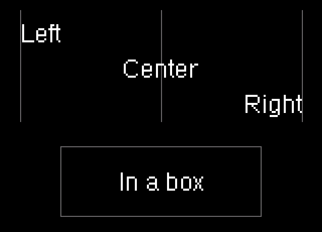
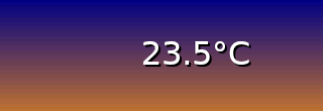
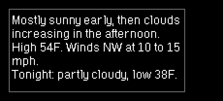
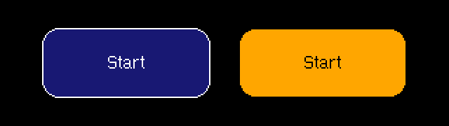
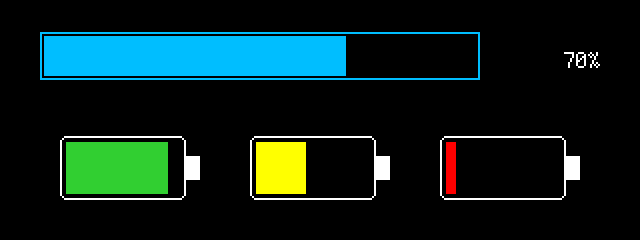

# DGX cookbook

[Русская версия](cookbook-ru.md)

Short answers to the small tasks that come up in almost every program with
a display: text set to the right or in the middle, a value that changes, a
button, a bar, the backlight, a picture that comes out wrong. The larger
features of DGX have their recipes in the [README](../README.md#recipes),
and every call is in the [API reference](api-en.md). The code here is
functions to copy into a program as they are. The pictures were drawn by this code on a
PC, by [docs/images/cookbook.c](https://github.com/jef-sure/esp32-component-dgx/blob/main/docs/images/cookbook.c).

## Contents

- [Text](#text)
  - [Text set right or centered](#text-set-right-or-centered)
  - [Text in the middle of a box](#text-in-the-middle-of-a-box)
  - [A value that changes in place](#a-value-that-changes-in-place)
  - [Text wrapped to a width](#text-wrapped-to-a-width)
  - [The degree sign and other characters](#the-degree-sign-and-other-characters)
- [Controls](#controls)
  - [A button](#a-button)
  - [A progress bar](#a-progress-bar)
  - [A battery icon](#a-battery-icon)
- [The display](#the-display)
  - [Dim the backlight, turn it off when idle](#dim-the-backlight-turn-it-off-when-idle)
  - [Draw only inside a rectangle](#draw-only-inside-a-rectangle)
  - [Two displays](#two-displays)
  - [When the picture looks wrong](#when-the-picture-looks-wrong)

## Text

`dgx_font_draw(ctx, x, y, str)` starts a text at `x` on its base line `y`
and returns how far it goes. `dgx_font_bounds(ctx, str, &top, &height)`
measures the same text without drawing it. It returns the same width, with
the scale counted, and gives the top of the highest letter above the base
line (a negative number) and the height of the letters. It takes only the
font and the scale from the context, so that context needs no screen. The
recipes of this part are built from these two calls.

### Text set right or centered



```c
/* The text ends at x. */
int text_right(const dgx_font_context_t *ctx, int x, int y, const char *str)
{
    return dgx_font_draw(ctx, x - dgx_font_bounds(ctx, str, NULL, NULL), y, str);
}

/* The middle of the text is at x. */
int text_center(const dgx_font_context_t *ctx, int x, int y, const char *str)
{
    return dgx_font_draw(ctx, x - dgx_font_bounds(ctx, str, NULL, NULL) / 2, y, str);
}
```

The width is the sum of the advances of the letters, the distance that
`dgx_font_draw()` moves along the line. For a value that changes, use a
field, see [A value that changes in place](#a-value-that-changes-in-place).

### Text in the middle of a box

```c
/* The text in the middle of a box, both ways, by its own letters. */
void text_in_box(const dgx_font_context_t *ctx, int x, int y, int w, int h, const char *str)
{
    int       top, height;
    const int width = dgx_font_bounds(ctx, str, &top, &height);
    dgx_font_draw(ctx, x + (w - width) / 2, y + (h - height) / 2 - top, str);
}
```

This centers the letters the text has, so "ace" and "Ady" end up at
different heights, each in the middle of its box. That is right for a
label. A text that changes, a clock or a reading, should keep its base line
still. For that, center the cell of the font, which is the same for every
text:

```c
/* The base line that puts the cell of the font in the middle of a box of height h at y. */
int base_line_in_box(const dgx_font_context_t *ctx, int y, int h)
{
    const int scale = ctx->scale ? ctx->scale : 1;
    const int top = ctx->font->y_offset_lowest * scale, bottom = ctx->font->y_bottom_max * scale;
    return y + (h - (bottom - top)) / 2 - top;
}
```

The cell runs from the highest top of any letter of the font to the lowest
bottom, accents and descenders included, so a text is near the middle of
the box rather than exactly in it, but its base line does not move.

### A value that changes in place

On a plain background, a field does the job. A text in a field paints the
whole field, so the new value replaces the old one in the same call,
however long either of them is. Give the field the color of the background:

```c
const dgx_font_context_t reading = {.scr = lcd, .font = font, .color = white, .bg = panel,
                                    .field = 100, .align = DGX_FONT_ALIGN_RIGHT};
char text[16];
snprintf(text, sizeof text, "%.1f", value);
dgx_font_draw(&reading, x, y, text); /* x is the left end of the field, y its base line */
```

On a display of 16 bits a pixel behind a bus, such as an ILI9341 or an
ST7789, the field goes out in one pass, every pixel of it once, so the value
does not blink. In a clock, the digits of most fonts all have the same
advance, so the colons stay in place.

A field paints its whole width. On a picture or a gradient it would leave a
box of `bg`, and with a shadow drawn by a second call, the field of the text
would paint over the shadow. There, draw the value into a small virtual
screen: first the piece of the background it covers, then the text, and
then send the piece to the display.



```c
static dgx_screen_t *piece; /* dgx_vscreen_init(180, 50, 16, DgxScreenRGB), made once */

/* The value at x, y of the display, its right end at the right end of the piece, with a shadow. */
static void show_temperature(dgx_screen_t *lcd, int x, int y, const char *text)
{
    draw_background(piece, x, y);
    const dgx_font_context_t shadow = {.scr = piece, .font = &dgx_font_temperature, .color = DGX_BLACK(dgx_rgb_to_16)};
    const dgx_font_context_t ink    = {.scr = piece, .font = &dgx_font_temperature, .color = DGX_WHITE(dgx_rgb_to_16)};
    const int                base   = base_line_in_box(&ink, 0, piece->height);
    text_right(&shadow, piece->width, base + 2, text);
    text_right(&ink, piece->width - 2, base, text);
    dgx_vscreen_to_screen(lcd, x, y, piece, 0);
}
```

`draw_background()` is the program's own: it draws into a screen the
background of the display as it lies starting at `x`, `y`. For a gradient
across the display, it is the same gradient moved up by `y`, `LCD_HEIGHT`
being the height of the display, and with 0, 0 it draws the whole
background:

```c
/* The background of the screen, a gradient from navy at its top to copper at its bottom, as it lies at x, y. */
static void draw_background(dgx_screen_t *piece, int x, int y)
{
    const dgx_round_rectangle_t r = {
        .w     = piece->width * DGX_SUBPIXEL,
        .h     = piece->height * DGX_SUBPIXEL,
        .paint = {.color  = DGX_NAVY(dgx_rgb_to_16),
                  .color2 = DGX_COPPER(dgx_rgb_to_16),
                  .gy     = {-y * DGX_SUBPIXEL, (LCD_HEIGHT - y) * DGX_SUBPIXEL},
                  .flags  = DGX_PAINT_LINEAR}};
    (void)x;
    dgx_fill_round_rectangle_with(piece, &r);
}
```

The display gets every pixel of the piece once, so nothing blinks there
either. A virtual screen can be read, so the soft edges of a font of 4 bits
a pixel mix with the gradient under them. The piece takes width x height x
2 bytes, 18000 for this one. The font with the degree sign is made at
build time, see [The degree sign and other characters](#the-degree-sign-and-other-characters).

### Text wrapped to a width



```c
/*
 * Draws str in lines no wider than w, breaking at spaces and at '\n'; the first base line is y.
 * Returns the base line after the last line. A word wider than w stands on a line of its own.
 */
int text_wrapped(const dgx_font_context_t *ctx, int x, int y, int w, const char *str)
{
    const int step = ctx->font->y_advance * (ctx->scale ? ctx->scale : 1);
    char      line[128];
    for (;;) {
        while (*str == ' ') ++str;
        if (*str == 0) return y;
        size_t end = 0; /* the line is str[0..end) */
        while (str[end] && str[end] != '\n') {
            size_t next = end;
            while (str[next] == ' ') ++next;
            if (str[next] == 0 || str[next] == '\n') break; /* only spaces to the end of the line */
            while (str[next] && str[next] != ' ' && str[next] != '\n') ++next;
            if (next >= sizeof line) break;
            memcpy(line, str, next);
            line[next] = 0;
            if (end > 0 && dgx_font_bounds(ctx, line, NULL, NULL) > w) break;
            end = next;
        }
        if (end == 0 && *str != '\n') { /* a word longer than the buffer: as much of it as fits */
            end = sizeof line - 1;
            while ((str[end] & 0xC0) == 0x80) --end; /* not in the middle of a character */
        }
        memcpy(line, str, end);
        line[end] = 0;
        dgx_font_draw(ctx, x, y, line);
        y += step;
        str += end;
        while (*str == ' ') ++str;
        if (*str == '\n') ++str;
    }
}
```

The lines step by `y_advance` of the font, the distance from one base line
to the next. A line is measured whole each time a word is added to it, so
the breaks are right for any font. A line holds up to 127 bytes; for a wider
screen, make `line` longer. To keep the text inside a box of a given height,
put the call inside a clip, see [Draw only inside a rectangle](#draw-only-inside-a-rectangle).

### The degree sign and other characters

DGX takes text in UTF-8, so `"23.5°C"` in the source works as it is, if
the font has the character. A character the font lacks is drawn as
nothing, and leaves a gap. Whether a font has one:
`dgx_font_glyph(font, 0xB0, NULL) != NULL`.

Of the fonts that come with DGX, `DroidSansRegular9`,
`LiberationSansRegular12`, `TerminusTTFMedium12`, `CozetteRegular13` and
`IBMCGALight8x16Light8x1616` have the degree sign, Latin-1 and Cyrillic.
`DejaVuSansBook32`, `IBMPlexMonoMedium28`, `NotoMonoRegular28` and
`GLCD5x7` have ASCII only. A font made at build time gets exactly the
characters it is asked for, so ask for the degree sign with the rest:

```cmake
# main/CMakeLists.txt, after idf_component_register()
dgx_font_need(temperature SIZE 32px POSTSCRIPT DejaVuSans BITS 4 LETTERS "0123456789.,-+°C")
```

`#include "dgx_fonts.h"` then gives `dgx_font_temperature`. Fonts made at
build time are described in [fonts-en.md](fonts-en.md).

## Controls

DGX draws, but it does not read a touch panel or buttons. The program reads
them, with a driver for its touch controller for example, and draws again
what has changed.

### A button



```c
void button(dgx_screen_t *scr, const dgx_font_t *font, int x, int y, int w, int h, const char *label, bool pressed)
{
    const uint32_t face = pressed ? DGX_ORANGE(dgx_rgb_to_16) : DGX_MIDNIGHTBLUE(dgx_rgb_to_16);
    const uint32_t ink  = pressed ? DGX_BLACK(dgx_rgb_to_16) : DGX_WHITE(dgx_rgb_to_16);
    dgx_fill_round_rectangle(scr, x, y, w, h, h / 4, face);
    dgx_draw_round_rectangle(scr, x, y, w, h, h / 4, ink);
    const dgx_font_context_t text = {.scr = scr, .font = font, .color = ink, .bg = face, .flags = DGX_FONT_BG};
    text_in_box(&text, x, y, w, h, label);
}

bool button_hit(int x, int y, int w, int h, int touch_x, int touch_y)
{
    return touch_x >= x && touch_x < x + w && touch_y >= y && touch_y < y + h;
}
```

Draw the button with `pressed` true while it is touched, and false once
it is released. `DGX_FONT_BG` mixes the soft edges of a font of 2 or 4
bits a pixel with the face of the button, so the label looks the same on a
display that cannot be read. The colors are made for a screen of 16 bits
a pixel; for another depth, make them with its `dgx_rgb_to_*()`.

### A progress bar



```c
/* A bar of w x h at x, y, done to `percent`: every pixel written once, so it does not blink. */
void progress_bar(dgx_screen_t *scr, int x, int y, int w, int h, int percent, uint32_t done, uint32_t rest)
{
    const int inner = w - 4, filled = inner * percent / 100;
    dgx_draw_rectangle(scr, x, y, w, h, done);
    dgx_draw_rectangle(scr, x + 1, y + 1, w - 2, h - 2, rest);
    dgx_fill_rectangle(scr, x + 2, y + 2, filled, h - 4, done);
    dgx_fill_rectangle(scr, x + 2 + filled, y + 2, inner - filled, h - 4, rest);
}
```

The frame, the gap inside it, the done part and the rest do not overlap, so
the bar can be drawn again at every step. The number beside it goes in a
field, which takes away the old number:

```c
const dgx_font_context_t percent = {.scr = lcd, .font = font, .color = white, .bg = black,
                                    .field = 50, .align = DGX_FONT_ALIGN_RIGHT};
snprintf(text, sizeof text, "%d%%", p);
dgx_font_draw(&percent, 250, 33, text);
```

### A battery icon

```c
/* A battery of w x h at x, y, its charge `level` 0 to 100, on a background of the color `back`. */
void battery(dgx_screen_t *scr, int x, int y, int w, int h, int level, uint32_t back)
{
    const uint32_t frame  = DGX_WHITE(dgx_rgb_to_16);
    const uint32_t charge = level < 20   ? DGX_RED(dgx_rgb_to_16)
                            : level < 50 ? DGX_YELLOW(dgx_rgb_to_16)
                                         : DGX_LIMEGREEN(dgx_rgb_to_16);
    const int      tip = w / 10 > 2 ? w / 10 : 2, body = w - tip;
    const int      inner = body - 6, filled = inner * level / 100;
    dgx_draw_round_rectangle(scr, x, y, body, h, 3, frame);
    dgx_fill_rectangle(scr, x + body, y + h / 3, tip, h - 2 * (h / 3), frame);
    dgx_fill_rectangle(scr, x + 3, y + 3, filled, h - 6, charge);
    dgx_fill_rectangle(scr, x + 3 + filled, y + 3, inner - filled, h - 6, back);
}
```

The charge is green above half, yellow below it and red below a fifth. As
the bar does, the icon writes the charged and the empty part separately, so
it can be drawn again over itself.

## The display

### Dim the backlight, turn it off when idle

`dgx_screen_backlight()` turns the backlight line on and off, nothing more.
For anything in between, drive the line with the LEDC PWM of ESP-IDF, and
give the constructor of the display `GPIO_NUM_NC` for its backlight:

```c
#include "driver/ledc.h"
#include "esp_timer.h"

/* The backlight line by PWM; the constructor of the display gets GPIO_NUM_NC in its place. */
void backlight_init(gpio_num_t pin)
{
    const ledc_timer_config_t timer = {.speed_mode      = LEDC_LOW_SPEED_MODE,
                                       .duty_resolution = LEDC_TIMER_8_BIT,
                                       .timer_num       = LEDC_TIMER_0,
                                       .freq_hz         = 5000,
                                       .clk_cfg         = LEDC_AUTO_CLK};
    ESP_ERROR_CHECK(ledc_timer_config(&timer));
    const ledc_channel_config_t channel = {
        .gpio_num = pin, .speed_mode = LEDC_LOW_SPEED_MODE, .channel = LEDC_CHANNEL_0, .timer_sel = LEDC_TIMER_0, .duty = 255};
    ESP_ERROR_CHECK(ledc_channel_config(&channel));
    ESP_ERROR_CHECK(ledc_fade_func_install(0));
}

/* The brightness, 0 dark to 255 full, reached in `ms` milliseconds. */
void backlight_fade(int level, int ms)
{
    ledc_set_fade_time_and_start(LEDC_LOW_SPEED_MODE, LEDC_CHANNEL_0, level, ms, LEDC_FADE_NO_WAIT);
}

/* Called from the main loop: dim after 30 s without input, dark after 60 s, full again at once. */
void screen_saver(int64_t last_input_us)
{
    static int    shown  = 255;
    const int64_t idle_s = (esp_timer_get_time() - last_input_us) / 1000000;
    const int     level  = idle_s < 30 ? 255 : idle_s < 60 ? 24 : 0;
    if (level == shown) return;
    backlight_fade(level, level > shown ? 100 : 1500);
    shown = level;
}
```

The program keeps the time of the last touch or press, from
`esp_timer_get_time()`. A module whose backlight is on when its line is
low takes `.flags.output_invert = 1` in the channel.

An OLED has no backlight. It has a brightness of its own, and with the picture off it
lights no pixel, which also keeps it from burning in. Its controller keeps
the picture, which comes back with `dgx_screen_display(oled, true)`:

```c
/* An OLED has no backlight: its own brightness, and the picture off. */
void oled_saver(dgx_screen_t *oled, int64_t last_input_us)
{
    const int64_t idle_s = (esp_timer_get_time() - last_input_us) / 1000000;
    dgx_screen_brightness(oled, idle_s < 30 ? 255 : 0);
    dgx_screen_display(oled, idle_s < 60);
}
```

### Draw only inside a rectangle

```c
dgx_screen_clip(lcd, 20, 40, 200, 100); /* drawing changes only this rectangle */
draw_graph(lcd);                        /* a line that runs past it is cut at its edges */
dgx_screen_unclip(lcd);
```

The clip holds for every call that changes pixels: figures, text, pictures.
The coordinates stay those of the screen. A new clip replaces the old one;
to draw inside both, give their common part. A function that draws in a box
of its own and leaves the clip as it found it:

```c
int cx, cy, cw, ch;
dgx_screen_clip_get(lcd, &cx, &cy, &cw, &ch);
dgx_screen_clip(lcd, x, y, w, h);
/* ... the drawing of the box ... */
dgx_screen_clip(lcd, cx, cy, cw, ch);
```

### Two displays

A screen of DGX keeps all its state in itself, so two displays are two
screens, drawn independently. On an ESP32 or an ESP32-S3, each can have an
SPI host of its own:

```c
dgx_bus_protocols_t *bus_l = dgx_spi_init(SPI2_HOST, SPI_DMA_CH_AUTO, GPIO_NUM_13, GPIO_NUM_NC, GPIO_NUM_14, GPIO_NUM_15, GPIO_NUM_2, 40000000, 0);
dgx_bus_protocols_t *bus_r = dgx_spi_init(SPI3_HOST, SPI_DMA_CH_AUTO, GPIO_NUM_23, GPIO_NUM_NC, GPIO_NUM_18, GPIO_NUM_5, GPIO_NUM_16, 40000000, 0);
```

A chip with one SPI host for displays, such as an ESP32-C3 or C6, takes both
on it: the same MOSI and SCLK pins, and a CS and a DC for each display:

```c
dgx_bus_protocols_t *bus_l = dgx_spi_init(SPI2_HOST, SPI_DMA_CH_AUTO, GPIO_NUM_7, GPIO_NUM_NC, GPIO_NUM_6, GPIO_NUM_10, GPIO_NUM_3, 40000000, 0);
dgx_bus_protocols_t *bus_r = dgx_spi_init(SPI2_HOST, SPI_DMA_CH_AUTO, GPIO_NUM_7, GPIO_NUM_NC, GPIO_NUM_6, GPIO_NUM_1, GPIO_NUM_2, 40000000, 0);
```

Then a screen on each bus. If both displays are wired to one reset line,
give it to the first constructor only. The second gets `GPIO_NUM_NC`, so
it does not reset the first after that one has been set up:

```c
left  = dgx_st7789_init(bus_l, GPIO_NUM_4, GPIO_NUM_NC, 16, DgxScreenRGB, DGX_ST7789_240X240);
right = dgx_st7789_init(bus_r, GPIO_NUM_NC, GPIO_NUM_NC, 16, DgxScreenRGB, DGX_ST7789_240X240);
```

To draw on two displays side by side as one wide screen, use
`dgx_vscreen_2h_init(left, right)` from `drivers/vscreen_2h.h`, with
`CONFIG_DGX_ENABLE_VSCREEN_2H`. It sends what is drawn on it to the one
display or the other, by x. Who owns a shared bus, and other devices on
it: [Bus backends](api-en.md#bus-backends).

### When the picture looks wrong

Table 1. What a wrong picture usually means, and what to change.

| What the display shows | What to change |
| --- | --- |
| Red and blue are swapped | The color order: `DgxScreenBGR` in place of `DgxScreenRGB` in the constructor, or back. |
| A negative: black is white, every color inverted | The module needs its colors inverted, or not. See [A panel of your own module](panels-en.md#a-panel-of-your-own-module), where a module that needs them inverted gets INVON. |
| The picture is shifted, with noise along two edges | The glass lies elsewhere in the memory of the controller: take the resolution of the driver for this glass, such as `DGX_ST7789_135X240` or `DGX_ST7735_80X160`, or describe the module in a panel of your own with its `x_offset` and `y_offset`. |
| A 1.3" OLED sold as an SSD1306 shows garbage in the top eight rows and nothing below | It is an SH1106: `dgx_sh1106_init()`. |
| Mirrored, upside down or turned | `dgx_screen_orientation()`, see [Rotate the screen](../README.md#rotate-the-screen). |
| Stripes, shifted lines or stray pixels, more of them at a high clock | A lower SPI clock, 20 MHz in place of 40, and shorter wires. |
| Nothing at all, or a white screen | The wiring of CS, DC and RESET, and the backlight. A constructor that fails logs an error and returns NULL. |

The drivers and their options are in [panels-en.md](panels-en.md).
