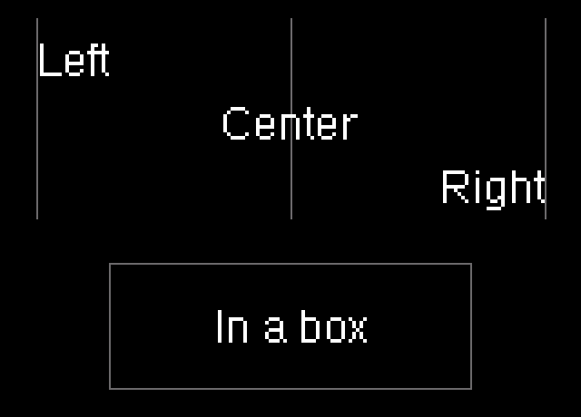
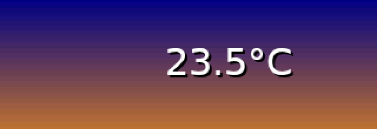
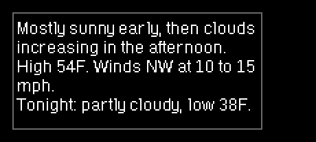
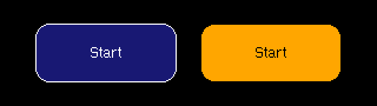
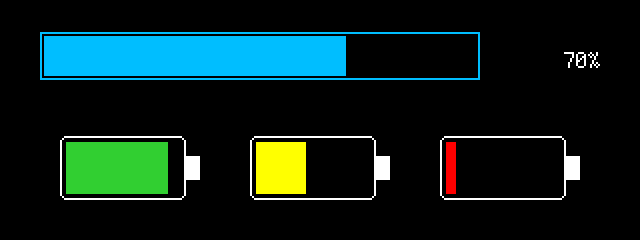

# Рецепты DGX на каждый день

[English version](cookbook-en.md)

Короткие ответы на мелкие задачи, которые встают почти в любой программе с
дисплеем: текст по правому краю или по центру, меняющееся значение, кнопка,
полоса прогресса, подсветка, картинка, которая вышла не такой. Рецепты
крупных возможностей DGX — в [README](../README.md#recipes), все вызовы — в
[справочнике API](api-en.md). Код здесь — функции, которые можно взять в
программу как есть. Картинки нарисованы этим же кодом на компьютере, файлом
[docs/images/cookbook.c](https://github.com/jef-sure/esp32-component-dgx/blob/main/docs/images/cookbook.c).

## Содержание

- [Текст](#текст)
  - [Текст по правому краю и по центру](#текст-по-правому-краю-и-по-центру)
  - [Текст посередине рамки](#текст-посередине-рамки)
  - [Значение, которое меняется на месте](#значение-которое-меняется-на-месте)
  - [Перенос текста по ширине](#перенос-текста-по-ширине)
  - [Знак градуса и другие символы](#знак-градуса-и-другие-символы)
- [Элементы управления](#элементы-управления)
  - [Кнопка](#кнопка)
  - [Полоса прогресса](#полоса-прогресса)
  - [Значок батареи](#значок-батареи)
  - [Значок из PNG, в нескольких состояниях](#значок-из-png-в-нескольких-состояниях)
- [Дисплей](#дисплей)
  - [Яркость подсветки и гашение в простое](#яркость-подсветки-и-гашение-в-простое)
  - [Рисовать только внутри прямоугольника](#рисовать-только-внутри-прямоугольника)
  - [Два дисплея](#два-дисплея)
  - [Если картинка выглядит неправильно](#если-картинка-выглядит-неправильно)

## Текст

`dgx_font_draw(ctx, x, y, str)` начинает текст в точке `x` на базовой линии
`y` и возвращает, сколько он занял по длине. `dgx_font_bounds(ctx, str,
&top, &height)` измеряет тот же текст, не рисуя его. Она возвращает ту же
ширину с учётом масштаба, а в `top` и `height` кладёт верх самой высокой
буквы над базовой линией (число отрицательное) и высоту букв. Из контекста
ей нужны только шрифт и масштаб, поэтому экран в нём можно не указывать. Все
рецепты этого раздела собраны из этих двух вызовов.

### Текст по правому краю и по центру



```c
/* Текст кончается в x. */
int text_right(const dgx_font_context_t *ctx, int x, int y, const char *str)
{
    return dgx_font_draw(ctx, x - dgx_font_bounds(ctx, str, NULL, NULL), y, str);
}

/* Середина текста в x. */
int text_center(const dgx_font_context_t *ctx, int x, int y, const char *str)
{
    return dgx_font_draw(ctx, x - dgx_font_bounds(ctx, str, NULL, NULL) / 2, y, str);
}
```

Ширина — это сумма шагов букв, то есть расстояние, на которое
`dgx_font_draw()` продвигается по строке. Для значения, которое меняется,
лучше поле, см. [Значение, которое меняется на месте](#значение-которое-меняется-на-месте).

### Текст посередине рамки

```c
/* Текст посередине рамки по обеим осям, по его собственным буквам. */
void text_in_box(const dgx_font_context_t *ctx, int x, int y, int w, int h, const char *str)
{
    int       top, height;
    const int width = dgx_font_bounds(ctx, str, &top, &height);
    dgx_font_draw(ctx, x + (w - width) / 2, y + (h - height) / 2 - top, str);
}
```

Так посередине оказываются те буквы, которые есть в тексте: «ace» и «Ady»
встанут на разной высоте, каждое посередине своей рамки. Для надписи это
то, что нужно. А у текста, который меняется, например часов или показаний
датчика, базовая линия не должна прыгать. Для него посередине рамки ставят
всю высоту шрифта, одинаковую для любого текста:

```c
/* Базовая линия, при которой высота шрифта приходится на середину рамки высотой h, начиная с y. */
int base_line_in_box(const dgx_font_context_t *ctx, int y, int h)
{
    const int scale = ctx->scale ? ctx->scale : 1;
    const int top = ctx->font->y_offset_lowest * scale, bottom = ctx->font->y_bottom_max * scale;
    return y + (h - (bottom - top)) / 2 - top;
}
```

Высота шрифта считается от самого высокого верха до самого низкого низа
всех его букв, с надстрочными знаками и хвостами. Поэтому текст встаёт не
точно посередине, а около неё, зато базовая линия не сдвигается.

### Значение, которое меняется на месте

На однотонном фоне хватает поля. Текст в поле закрашивает всё поле, так что
новое значение заменяет старое тем же вызовом, какой бы длины ни были оба.
Полю дают цвет фона:

```c
const dgx_font_context_t reading = {.scr = lcd, .font = font, .color = white, .bg = panel,
                                    .field = 100, .align = DGX_FONT_ALIGN_RIGHT};
char text[16];
snprintf(text, sizeof text, "%.1f", value);
dgx_font_draw(&reading, x, y, text); /* x — левый край поля, y — его базовая линия */
```

На 16-битном дисплее за шиной, например ILI9341 или ST7789, поле уходит за
один проход, каждая его точка один раз, поэтому значение не мигает. В часах
двоеточия стоят на месте: у большинства шрифтов все цифры одной ширины.

Поле закрашивает всю свою ширину. На картинке или градиенте от него
останется прямоугольник цвета `bg`, а если тень рисуется вторым вызовом,
поле текста закрасит тень. Тогда значение рисуют в маленький виртуальный
экран: сначала кусок фона, который оно закрывает, потом текст, потом этот
кусок отправляют на дисплей.



```c
static dgx_screen_t *piece; /* dgx_vscreen_init(180, 50, 16, DgxScreenRGB), создаётся один раз */

/* Значение в точке x, y дисплея, правым краем у правого края куска, с тенью. */
static void show_temperature(dgx_screen_t *lcd, int x, int y, const char *text)
{
    draw_background(piece, x, y);
    const dgx_font_context_t shadow = {.scr = piece, .font = &dgx_font_temperature, .color = DGX_BLACK(dgx_rgb_to_16)};
    const dgx_font_context_t ink    = {.scr = piece, .font = &dgx_font_temperature, .color = DGX_WHITE(dgx_rgb_to_16)};
    const int                base   = base_line_in_box(&ink, 0, piece->height);
    text_right(&shadow, piece->width, base + 2, text);
    text_right(&ink, piece->width - 2, base, text);
    dgx_vscreen_to_screen(lcd, x, y, piece, 0);
}
```

`draw_background()` пишет сама программа: функция рисует в экран фон
дисплея таким, каким он лежит начиная с точки `x`, `y`. Для градиента во
весь дисплей это тот же градиент, сдвинутый вверх на `y` (`LCD_HEIGHT` —
высота дисплея), а с 0, 0 она рисует весь фон:

```c
/* Фон экрана, градиент от тёмно-синего вверху к медному внизу, таким, каким он лежит в точке x, y. */
static void draw_background(dgx_screen_t *piece, int x, int y)
{
    const dgx_round_rectangle_t r = {
        .w     = piece->width * DGX_SUBPIXEL,
        .h     = piece->height * DGX_SUBPIXEL,
        .paint = {.color  = DGX_NAVY(dgx_rgb_to_16),
                  .color2 = DGX_COPPER(dgx_rgb_to_16),
                  .gy     = {-y * DGX_SUBPIXEL, (LCD_HEIGHT - y) * DGX_SUBPIXEL},
                  .flags  = DGX_PAINT_LINEAR}};
    (void)x;
    dgx_fill_round_rectangle_with(piece, &r);
}
```

Дисплей получает каждую точку куска один раз, поэтому и здесь ничего не
мигает. Виртуальный экран можно читать, так что мягкие края шрифта в 4 бита
на точку смешиваются с градиентом под ними. Кусок занимает ширину × высоту
× 2 байта, этот — 18000 байт. Шрифт со знаком градуса делается при сборке, см.
[Знак градуса и другие символы](#знак-градуса-и-другие-символы).

### Перенос текста по ширине



```c
/*
 * Рисует str строками не шире w, разрывая их на пробелах и на '\n'; первая базовая линия — y.
 * Возвращает базовую линию после последней строки. Слово шире w встаёт на отдельную строку.
 */
int text_wrapped(const dgx_font_context_t *ctx, int x, int y, int w, const char *str)
{
    const int step = ctx->font->y_advance * (ctx->scale ? ctx->scale : 1);
    char      line[128];
    for (;;) {
        while (*str == ' ') ++str;
        if (*str == 0) return y;
        size_t end = 0; /* строка — это str[0..end) */
        while (str[end] && str[end] != '\n') {
            size_t next = end;
            while (str[next] == ' ') ++next;
            if (str[next] == 0 || str[next] == '\n') break; /* до конца строки одни пробелы */
            while (str[next] && str[next] != ' ' && str[next] != '\n') ++next;
            if (next >= sizeof line) break;
            memcpy(line, str, next);
            line[next] = 0;
            if (end > 0 && dgx_font_bounds(ctx, line, NULL, NULL) > w) break;
            end = next;
        }
        if (end == 0 && *str != '\n') { /* слово длиннее буфера: сколько его влезет */
            end = sizeof line - 1;
            while ((str[end] & 0xC0) == 0x80) --end; /* не посреди символа */
        }
        memcpy(line, str, end);
        line[end] = 0;
        dgx_font_draw(ctx, x, y, line);
        y += step;
        str += end;
        while (*str == ' ') ++str;
        if (*str == '\n') ++str;
    }
}
```

Строки идут с шагом `y_advance` шрифта — расстоянием от одной базовой линии
до следующей. После каждого добавленного слова строка измеряется целиком,
поэтому разрывы верны для любого шрифта. В строку помещается до 127 байт;
для широкого экрана буфер `line` надо сделать длиннее. Чтобы текст не
выходил за рамку по высоте, вызов ставят внутрь обрезки, см.
[Рисовать только внутри прямоугольника](#рисовать-только-внутри-прямоугольника).

### Знак градуса и другие символы

DGX принимает текст в UTF-8, поэтому `"23.5°C"` в исходнике работает как
есть, если в шрифте есть такой символ. Символ, которого в шрифте нет, не
рисуется, и на его месте остаётся промежуток. Есть ли символ в шрифте,
показывает `dgx_font_glyph(font, 0xB0, NULL) != NULL`.

Из шрифтов, которые идут с DGX, знак градуса, Latin-1 и кириллица есть в
`DroidSansRegular9`, `LiberationSansRegular12`, `TerminusTTFMedium12`,
`CozetteRegular13` и `IBMCGALight8x16Light8x1616`. В `DejaVuSansBook32`,
`IBMPlexMonoMedium28`, `NotoMonoRegular28` и `GLCD5x7` только ASCII. Шрифт,
который делается при сборке, получает ровно те символы, которые у него
попросили, поэтому знак градуса просят вместе с остальными:

```cmake
# main/CMakeLists.txt, после idf_component_register()
dgx_font_need(temperature SIZE 32px POSTSCRIPT DejaVuSans BITS 4 LETTERS "0123456789.,-+°C")
```

После `#include "dgx_fonts.h"` шрифт доступен как `dgx_font_temperature`.
Как устроены шрифты, сделанные при сборке, — в [fonts-ru.md](fonts-ru.md).

## Элементы управления

DGX рисует, но не опрашивает сенсорную панель и кнопки. Их опрашивает
программа, например драйвером своего сенсорного контроллера, и
перерисовывает то, что изменилось.

### Кнопка



```c
void button(dgx_screen_t *scr, const dgx_font_t *font, int x, int y, int w, int h, const char *label, bool pressed)
{
    const uint32_t face = pressed ? DGX_ORANGE(dgx_rgb_to_16) : DGX_MIDNIGHTBLUE(dgx_rgb_to_16);
    const uint32_t ink  = pressed ? DGX_BLACK(dgx_rgb_to_16) : DGX_WHITE(dgx_rgb_to_16);
    dgx_fill_round_rectangle(scr, x, y, w, h, h / 4, face);
    dgx_draw_round_rectangle(scr, x, y, w, h, h / 4, ink);
    const dgx_font_context_t text = {.scr = scr, .font = font, .color = ink, .bg = face, .flags = DGX_FONT_BG};
    text_in_box(&text, x, y, w, h, label);
}

bool button_hit(int x, int y, int w, int h, int touch_x, int touch_y)
{
    return touch_x >= x && touch_x < x + w && touch_y >= y && touch_y < y + h;
}
```

Пока кнопку держат, её рисуют с `pressed`, равным true, а когда отпустят —
с false. `DGX_FONT_BG` смешивает мягкие края шрифта в 2 или 4 бита на точку
с цветом кнопки, поэтому надпись выглядит так же и на дисплее, который
нельзя читать. Цвета здесь для экрана в 16 бит на точку; для другой глубины
их делают её функцией `dgx_rgb_to_*()`.

### Полоса прогресса



```c
/* Полоса w x h в точке x, y, выполненная на percent: каждая точка пишется один раз, поэтому не мигает. */
void progress_bar(dgx_screen_t *scr, int x, int y, int w, int h, int percent, uint32_t done, uint32_t rest)
{
    const int inner = w - 4, filled = inner * percent / 100;
    dgx_draw_rectangle(scr, x, y, w, h, done);
    dgx_draw_rectangle(scr, x + 1, y + 1, w - 2, h - 2, rest);
    dgx_fill_rectangle(scr, x + 2, y + 2, filled, h - 4, done);
    dgx_fill_rectangle(scr, x + 2 + filled, y + 2, inner - filled, h - 4, rest);
}
```

Рамка, зазор внутри неё, выполненная часть и остаток не перекрываются,
поэтому полосу можно перерисовывать на каждом шаге. Число рядом пишут в
поле, оно убирает прежнее число:

```c
const dgx_font_context_t percent = {.scr = lcd, .font = font, .color = white, .bg = black,
                                    .field = 50, .align = DGX_FONT_ALIGN_RIGHT};
snprintf(text, sizeof text, "%d%%", p);
dgx_font_draw(&percent, 250, 33, text);
```

### Значок батареи

```c
/* Батарея w x h в точке x, y с зарядом level от 0 до 100, на фоне цвета back. */
void battery(dgx_screen_t *scr, int x, int y, int w, int h, int level, uint32_t back)
{
    const uint32_t frame  = DGX_WHITE(dgx_rgb_to_16);
    const uint32_t charge = level < 20   ? DGX_RED(dgx_rgb_to_16)
                            : level < 50 ? DGX_YELLOW(dgx_rgb_to_16)
                                         : DGX_LIMEGREEN(dgx_rgb_to_16);
    const int      tip = w / 10 > 2 ? w / 10 : 2, body = w - tip;
    const int      inner = body - 6, filled = inner * level / 100;
    dgx_draw_round_rectangle(scr, x, y, body, h, 3, frame);
    dgx_fill_rectangle(scr, x + body, y + h / 3, tip, h - 2 * (h / 3), frame);
    dgx_fill_rectangle(scr, x + 3, y + 3, filled, h - 6, charge);
    dgx_fill_rectangle(scr, x + 3 + filled, y + 3, inner - filled, h - 6, back);
}
```

Заряд зелёный, когда его больше половины, жёлтый, когда меньше, и красный,
когда меньше пятой части. Как и полоса, значок пишет заряженную и пустую
часть отдельно, поэтому его можно рисовать поверх прежнего.

### Значок из PNG, в нескольких состояниях

Состояния значка, нарисованные в графическом редакторе, каждое — PNG с
прозрачным фоном, при сборке становятся одним набором масок: каждый пиксель
хранит, насколько значок его покрывает, поэтому край остаётся мягким.

```cmake
# в CMakeLists.txt программы
dgx_image_need(wifi PNG art/wifi0.png art/wifi1.png art/wifi2.png art/wifi3.png BITS 4 MASK)
```

```c
#include "dgx_assets.h"
#include "dgx_image_file.h"

/* Значок Wi-Fi с bars делениями в точке x, y, цветом ink на фоне back: картинка набора wifi, рисуется целиком, чтобы не мигать. */
void wifi_icon(dgx_screen_t *scr, int x, int y, int bars, uint32_t ink, uint32_t back)
{
    static dgx_image_file_t file;
    if (!file.bytes && dgx_image_file_open(dgx_asset_wifi, dgx_asset_wifi_size, &file) != ESP_OK) return;
    dgx_image_t icon;
    if (dgx_image_file_image(&file, (unsigned)bars, &icon) != ESP_OK) return;
    dgx_image_blit(scr, x, y, &icon,
                   &(dgx_image_blit_t){.flags = DGX_IMAGE_SILHOUETTE | DGX_IMAGE_SOFT | DGX_IMAGE_OPAQUE, .color = ink, .bg = back});
}
```

Значок рисуется цветом `ink`, а его край смешивается с `back`: с
`DGX_IMAGE_OPAQUE` каждый пиксель его коробки пишется один раз, и новое
состояние поверх старого не мигает, на дисплее за шиной тоже. Картинки остаются во
flash, а значок можно рисовать на дисплее любой глубины. Картинка во многих
цветах, глубина набора, сокращение цветов PNG — в
[Картинках из PNG](pictures-ru.md).

## Дисплей

### Яркость подсветки и гашение в простое

`dgx_screen_backlight()` включает и выключает линию подсветки, и только.
Для промежуточной яркости линией управляют через ШИМ LEDC из ESP-IDF, а
конструктору дисплея вместо пина подсветки дают `GPIO_NUM_NC`:

```c
#include "driver/ledc.h"
#include "esp_timer.h"

/* Линия подсветки через ШИМ; конструктор дисплея получает вместо неё GPIO_NUM_NC. */
void backlight_init(gpio_num_t pin)
{
    const ledc_timer_config_t timer = {.speed_mode      = LEDC_LOW_SPEED_MODE,
                                       .duty_resolution = LEDC_TIMER_8_BIT,
                                       .timer_num       = LEDC_TIMER_0,
                                       .freq_hz         = 5000,
                                       .clk_cfg         = LEDC_AUTO_CLK};
    ESP_ERROR_CHECK(ledc_timer_config(&timer));
    const ledc_channel_config_t channel = {
        .gpio_num = pin, .speed_mode = LEDC_LOW_SPEED_MODE, .channel = LEDC_CHANNEL_0, .timer_sel = LEDC_TIMER_0, .duty = 255};
    ESP_ERROR_CHECK(ledc_channel_config(&channel));
    ESP_ERROR_CHECK(ledc_fade_func_install(0));
}

/* Яркость от 0 (темно) до 255 (полная), плавно за ms миллисекунд. */
void backlight_fade(int level, int ms)
{
    ledc_set_fade_time_and_start(LEDC_LOW_SPEED_MODE, LEDC_CHANNEL_0, level, ms, LEDC_FADE_NO_WAIT);
}

/* Вызывается из главного цикла: через 30 с без ввода тускнеет, через 60 с гаснет, при вводе сразу ярко. */
void screen_saver(int64_t last_input_us)
{
    static int    shown  = 255;
    const int64_t idle_s = (esp_timer_get_time() - last_input_us) / 1000000;
    const int     level  = idle_s < 30 ? 255 : idle_s < 60 ? 24 : 0;
    if (level == shown) return;
    backlight_fade(level, level > shown ? 100 : 1500);
    shown = level;
}
```

Время последнего касания или нажатия программа запоминает сама, по
`esp_timer_get_time()`. Если подсветка модуля горит при низком уровне,
каналу добавляют `.flags.output_invert = 1`.

У OLED подсветки нет. Он умеет убавлять собственную яркость, а с
выключенной картинкой не зажигает ни одной точки, что заодно бережёт его от
выгорания. Картинка остаётся в контроллере и возвращается вызовом
`dgx_screen_display(oled, true)`:

```c
/* У OLED нет подсветки: своя яркость и выключение картинки. */
void oled_saver(dgx_screen_t *oled, int64_t last_input_us)
{
    const int64_t idle_s = (esp_timer_get_time() - last_input_us) / 1000000;
    dgx_screen_brightness(oled, idle_s < 30 ? 255 : 0);
    dgx_screen_display(oled, idle_s < 60);
}
```

### Рисовать только внутри прямоугольника

```c
dgx_screen_clip(lcd, 20, 40, 200, 100); /* рисование меняет только этот прямоугольник */
draw_graph(lcd);                        /* линия, которая выходит за него, обрезается по краю */
dgx_screen_unclip(lcd);
```

Обрезка действует на все вызовы, которые меняют точки: фигуры, текст,
картинки. Координаты остаются координатами экрана. Новая обрезка заменяет
прежнюю; чтобы рисовать внутри обеих, задают их общую часть. Функция,
которая рисует в своей рамке и оставляет обрезку такой, какой её нашла:

```c
int cx, cy, cw, ch;
dgx_screen_clip_get(lcd, &cx, &cy, &cw, &ch);
dgx_screen_clip(lcd, x, y, w, h);
/* ... рисование в рамке ... */
dgx_screen_clip(lcd, cx, cy, cw, ch);
```

### Два дисплея

Экран DGX хранит всё своё состояние в себе, поэтому два дисплея — это
просто два экрана, которые рисуются независимо. На ESP32 и ESP32-S3 у
каждого может быть свой хост SPI:

```c
dgx_bus_protocols_t *bus_l = dgx_spi_init(SPI2_HOST, SPI_DMA_CH_AUTO, GPIO_NUM_13, GPIO_NUM_NC, GPIO_NUM_14, GPIO_NUM_15, GPIO_NUM_2, 40000000, 0);
dgx_bus_protocols_t *bus_r = dgx_spi_init(SPI3_HOST, SPI_DMA_CH_AUTO, GPIO_NUM_23, GPIO_NUM_NC, GPIO_NUM_18, GPIO_NUM_5, GPIO_NUM_16, 40000000, 0);
```

У чипа с одним хостом SPI для дисплеев, например ESP32-C3 или C6, оба
дисплея садятся на него: общие пины MOSI и SCLK, а CS и DC у каждого свои:

```c
dgx_bus_protocols_t *bus_l = dgx_spi_init(SPI2_HOST, SPI_DMA_CH_AUTO, GPIO_NUM_7, GPIO_NUM_NC, GPIO_NUM_6, GPIO_NUM_10, GPIO_NUM_3, 40000000, 0);
dgx_bus_protocols_t *bus_r = dgx_spi_init(SPI2_HOST, SPI_DMA_CH_AUTO, GPIO_NUM_7, GPIO_NUM_NC, GPIO_NUM_6, GPIO_NUM_1, GPIO_NUM_2, 40000000, 0);
```

Затем на каждой шине создают экран. Если оба дисплея сидят на одной линии
сброса, её дают только первому конструктору. Второй получает
`GPIO_NUM_NC` и потому не сбрасывает первый дисплей, когда тот уже
настроен:

```c
left  = dgx_st7789_init(bus_l, GPIO_NUM_4, GPIO_NUM_NC, 16, DgxScreenRGB, DGX_ST7789_240X240);
right = dgx_st7789_init(bus_r, GPIO_NUM_NC, GPIO_NUM_NC, 16, DgxScreenRGB, DGX_ST7789_240X240);
```

Чтобы рисовать на двух дисплеях рядом как на одном широком экране, есть
`dgx_vscreen_2h_init(left, right)` из `drivers/vscreen_2h.h`, с
`CONFIG_DGX_ENABLE_VSCREEN_2H`. Он отправляет нарисованное на тот или
другой дисплей по координате x. Кто владеет общей шиной и как на ней
уживаются другие устройства: [Bus backends](api-en.md#bus-backends).

### Если картинка выглядит неправильно

Таблица 1. Что обычно значит неправильная картинка и что поменять.

| Что на дисплее | Что поменять |
| --- | --- |
| Красный и синий поменялись местами | Порядок цветов: `DgxScreenBGR` вместо `DgxScreenRGB` в конструкторе или наоборот. |
| Негатив: чёрное стало белым, все цвета обращены | Модулю нужна инверсия цветов или, наоборот, не нужна. См. [A panel of your own module](panels-en.md#a-panel-of-your-own-module): там модулю, которому нужна инверсия, добавляют INVON. |
| Картинка сдвинута, вдоль двух краёв мусор | Стекло лежит в памяти контроллера не там: выбрать разрешение драйвера для этого стекла, например `DGX_ST7789_135X240` или `DGX_ST7735_80X160`, или описать модуль своей панелью с его `x_offset` и `y_offset`. |
| OLED 1,3", проданный как SSD1306, показывает мусор в верхних восьми строках, а ниже ничего | Это SH1106: `dgx_sh1106_init()`. |
| Зеркально, вверх ногами или повёрнуто | `dgx_screen_orientation()`, см. [Rotate the screen](../README.md#rotate-the-screen). |
| Полосы, сдвинутые строки или лишние точки, и их больше на высокой частоте | Частоту SPI пониже, 20 МГц вместо 40, и провода покороче. |
| Ничего нет или белый экран | Проводка CS, DC и RESET и подсветка. Если конструктор не справился, он пишет ошибку в лог и возвращает NULL. |

Драйверы и их параметры — в [panels-en.md](panels-en.md).
